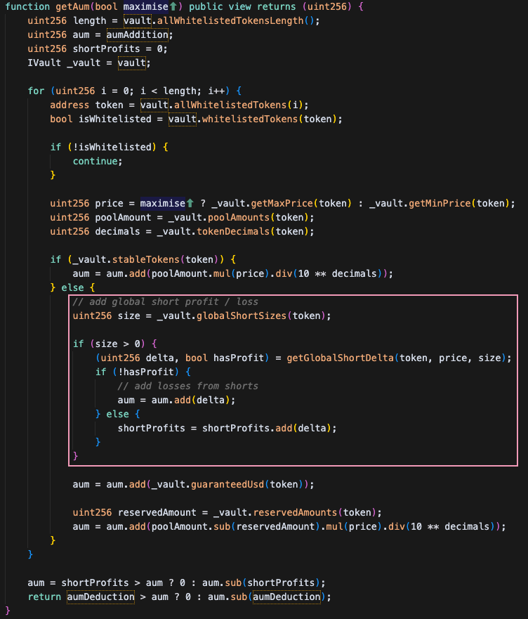

## What Happened

On July 9, 2025, [GMX v1 lost around ~\$42 million to an attack](https://x.com/GMX_IO/status/1942989975814820347) that exploited how the protocol calculated its total value (Assets Under Management or AUM). This was GMX's second hack of 2025, following a $13 million loss in March. The attacker used a reentrancy vulnerability to manipulate pricing data, artificially inflating the protocol's apparent value, then immediately withdrew tokens at the inflated price.

- [Exploit tx](http://arbiscan.io/tx/0x03182d3f0956a91c4e4c8f225bbc7975f9434fab042228c7acdc5ec9a32626ef)
- [Exploiter address Arbitrum](https://arbiscan.io/address/0xdf3340a436c27655ba62f8281565c9925c3a5221)
- [Exploiter address Mainnet](https://etherscan.io/address/0xdf3340a436c27655ba62f8281565c9925c3a5221)

## Why It Worked

The attack exploited a design flaw where short position operations immediately updated `globalShortAveragePrices`, which directly impacted AUM calculations used for GLP token minting and redemption. The attacker used reentrancy to establish massive short positions within a single transaction, artificially inflating GLP prices.

The critical vulnerability chain:
1. **Reentrancy entry point**: `executeDecreaseOrder` accepted a contract address instead of EOA
2. **State manipulation**: Opening short positions immediately updated global averages
3. **AUM inflation**: System counted unrealized short losses as vault "assets"
4. **Value extraction**: Inflated AUM allowed redemption of GLP for excessive assets

## How AUM Calculation Was Exploited

### Normal AUM Calculation
GMX calculates its total value using this formula:
```text
AUM = Physical Tokens + Stablecoins + Unrealized Trading Profits + Fees
```

The "unrealized trading profits" component was the vulnerability. When traders open short positions (betting prices will fall), the protocol tracks:
- **Average price** at which all shorts were opened
- **Current market price** of the asset
- **Difference** = profit/loss for the protocol



### Key Insight: Short Position Impact
The critical part is how short positions affect AUM:
- When shorts lose money (current price > average price): Vault profits, AUM increases
- When shorts make money (current price < average price): Vault loses, AUM decreases

### The Manipulation
1. Attacker deposited tokens to mint GLP (liquidity provider tokens)
2. Exploited reentrancy to gain control during a transaction
3. Opened massive short positions at artificially low average prices
4. AUM spiked significantly because the system thought it had huge unrealized profits from shorts
5. Redeemed GLP tokens at the inflated price, withdrawing $40M+ in real assets

## Critical Invariants That Could Have Prevented the Attack

Possible checks include AUM bounds, state consistency, and position limits:

### 1. AUM Manipulation Bounds Invariant
Implement a simple check that AUM changes must be reasonable. This invariant ensures that any change in the protocol's total value is bounded by actual token flows and reasonable market movements.

### 2. Atomic State Consistency Invariant
Ensure all state changes affecting token pricing complete atomically before any external calls. This prevents reentrancy-based manipulation of global price averages.

### 3. Price Update Monotonicity Invariant
Ensure global average prices update based on actual position changes, not synthetic operations. This maintains mathematical consistency in price calculations.

### 4. Caller Type Restriction Invariant
Critical financial operations must originate from externally owned accounts (EOAs) or pre-approved contracts. This prevents malicious contracts from exploiting reentrancy vulnerabilities.

### 5. Position-to-Pool Ratio Invariant
Individual positions must not exceed a maximum percentage of total pool value. This limits the impact any single position can have on global averages.

## Assertion Pattern

This example checks AUM changes for one call. A complete implementation must check the relevant calls throughout the transaction.

```solidity
function assertSimplifiedAUMBounds() external {
    // Core principle: AUM should closely track actual token flows

    // 1. Capture AUM before transaction
    PhEvm.ForkId memory preFork = _preTx();
    uint256 aumBefore = getAumInUsdg(true);

    // 2. Capture AUM after transaction
    PhEvm.ForkId memory postFork = _postTx();
    uint256 aumAfter = getAumInUsdg(true);

    // 3. Calculate AUM change
    uint256 aumChange = aumAfter > aumBefore ? aumAfter - aumBefore : aumBefore - aumAfter;

    // 4. Calculate percentage change
    uint256 percentageChange = aumBefore > 0 ? (aumChange * 10000) / aumBefore : 0;

    // 5. Core invariant: AUM should not change by more than 5% in a single transaction
    require(
        percentageChange <= MAX_AUM_DEVIATION_BPS,
        "SIMPLE_AUM_BOUNDS_VIOLATION: AUM changed by more than 5% in a single transaction"
    );

    // 6. Additional check: If AUM increased significantly, verify it's not artificial
    if (aumAfter > aumBefore) {
        uint256 aumIncrease = aumAfter - aumBefore;

        // If AUM increased by more than $10M, revert
        require(
            aumIncrease <= MAX_ABSOLUTE_AUM_DEVIATION,
            "LARGE_AUM_INCREASE: AUM increased by more than $10M in a single transaction"
        );
    }
}
```

### How the Assertion Would Have Prevented It

The assertion compares AUM before and after execution. Its example limits are a 5% deviation and a $10M increase. The attack's artificial increase exceeded both limits.

Tune these values to the protocol and test legitimate operations before deployment.

## Key Takeaways

AUM checks can constrain accounting changes that exceed the configured limits. Their coverage depends on the selected thresholds and inspected execution states.
