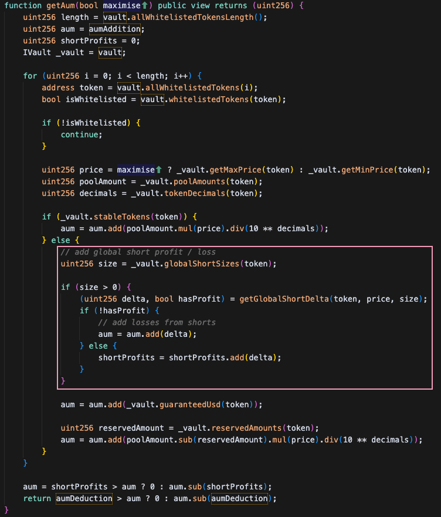

## What Happened

GMX’s recovery report identifies the July 9, 2025 incident as affecting GLP on Arbitrum in GMX V1 and reports recovery after a $5 million bounty. Its account distinguishes V1 from V2. The incident involved reentrancy and inconsistent short-position accounting used in valuation. [GMX recovery report](https://gmxio.substack.com/p/glp-funds-on-arbitrum-fully-recovered).

## Attack Mechanism

GMX V1 valued GLP using assets under management, including the effect of global short positions. When shorts lose, the pool's claim against those positions can increase AUM; when shorts profit, the liability reduces it. AUM therefore depends on consistent position sizes and average prices, not only tokens held in custody.

Reentrancy exposed a window in which position accounting used for valuation was inconsistent. The attacker could move through that window, affect the apparent value of GLP, and redeem against the inflated value. The relevant failure was the accounting state visible during the callback; accepting a contract caller is not itself a vulnerability.



The example reads `getAumInUsdg(true)` on the configured GLP manager, both before and after each selected value-sensitive operation. Set `query` to `abi.encodeWithSignature("getAumInUsdg(bool)", true)` and `operation` to the deployed mint/redemption entry point. A 500-bps bound represents a proposed 5% policy, not a measured normal-operation limit.

## Assertion Example

```solidity
// SPDX-License-Identifier: MIT
pragma solidity 0.8.29;

import {Assertion} from "credible-std/Assertion.sol";
import {AssertionSpec} from "credible-std/SpecRecorder.sol";
import {PhEvm} from "credible-std/PhEvm.sol";

/// @notice Bound a configured metric before and after every covered operation.
contract CallMetricBounds is Assertion {
    address public immutable reader;
    bytes public query;
    bytes4 public immutable operation;
    uint256 public immutable maximumBps;
    constructor(address reader_, bytes memory query_, bytes4 operation_, uint256 maximumBps_) {
        registerAssertionSpec(AssertionSpec.Reshiram);
        require(reader_ != address(0) && query_.length >= 4, "Invalid reader");
        reader = reader_; query = query_; operation = operation_; maximumBps = maximumBps_;
    }
    function triggers() external view override { registerTxEndTrigger(this.check.selector); }
    function check() external view {
        address target = ph.getAssertionAdopter();
        uint256 start = abi.decode(read(reader, query, _preTx()), (uint256));
        require(start > 0 && start <= type(uint128).max && maximumBps <= 100_000, "Invalid baseline or bound");
        uint256 allowed = start * maximumBps / 10_000;
        PhEvm.CallInputs[] memory calls = ph.getCallInputs(target, operation);
        for (uint256 i; i < calls.length; ++i) {
            within(start, allowed, _preCall(calls[i].id));
            within(start, allowed, _postCall(calls[i].id));
        }
    }
    function within(uint256 start, uint256 allowed, PhEvm.ForkId memory at) internal view {
        uint256 value = abi.decode(read(reader, query, at), (uint256));
        uint256 delta = value >= start ? value - start : start - value;
        require(delta <= allowed, "Metric outside bound");
    }

    function read(address target, bytes memory data, PhEvm.ForkId memory fork)
        internal view returns (bytes memory)
    {
        PhEvm.StaticCallResult memory result = ph.staticcallAt(target, data, 500_000, fork);
        require(result.ok, "Snapshot read failed");
        return result.data;
    }
}
```

## What This Check Covers

AUM legitimately changes with deposits, withdrawals, prices, and positions. This bound does not reconcile those flows or prove the short-accounting invariant. To catch a temporary reentrant valuation, the covered call boundary must expose that state; a restored outer-call snapshot can miss it. The March 2025 Abracadabra GMX V2 incident is a separate protocol incident.

<span id="why-it-worked" />
<span id="how-aum-calculation-was-exploited" />
<span id="normal-aum-calculation" />
<span id="key-insight-short-position-impact" />
<span id="the-manipulation" />
<span id="critical-invariants-that-could-have-prevented-the-attack" />
<span id="1-aum-manipulation-bounds-invariant" />
<span id="2-atomic-state-consistency-invariant" />
<span id="3-price-update-monotonicity-invariant" />
<span id="4-caller-type-restriction-invariant" />
<span id="5-position-to-pool-ratio-invariant" />
<span id="assertion-pattern" />
<span id="how-the-assertion-would-have-prevented-it" />
<span id="key-takeaways" />

## Further Sources

- [GMX incident statement](https://x.com/GMX_IO/status/1942989975814820347)
- [Exploit tx](http://arbiscan.io/tx/0x03182d3f0956a91c4e4c8f225bbc7975f9434fab042228c7acdc5ec9a32626ef)
- [Exploiter address Arbitrum](https://arbiscan.io/address/0xdf3340a436c27655ba62f8281565c9925c3a5221)
- [Exploiter address Mainnet](https://etherscan.io/address/0xdf3340a436c27655ba62f8281565c9925c3a5221)
