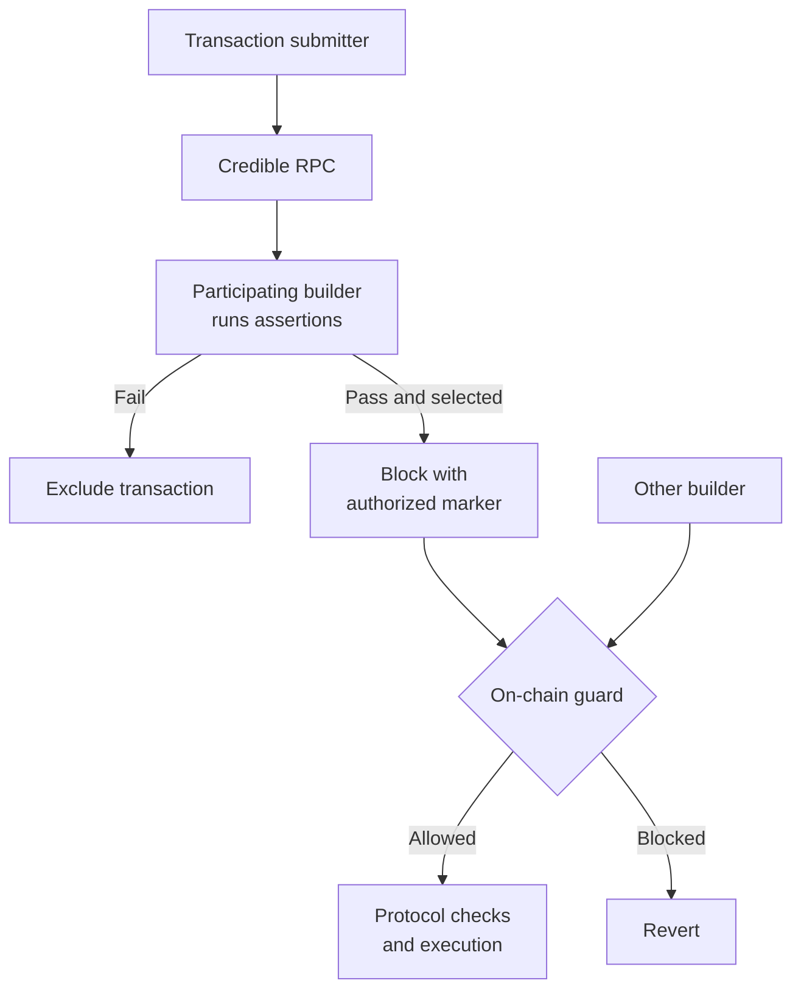
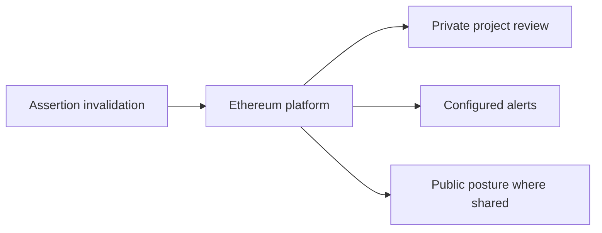

On Ethereum, the Credible Layer combines off-chain assertion validation by participating builders with an on-chain guard on protected operations. The Credible RPC routes submissions to those builders. Ethereum validators do not independently execute Phylax assertions as part of consensus.

For a shorter introduction, see [How Ethereum Enforcement Works](./credible-layer-overview). The earlier sequencer model is documented separately under [L2 and Sequencer Integrations](./l2-integrations/overview).

## System Overview

| Component | Role |
| --- | --- |
| Assertions | Solidity rules and triggers that describe the transaction effects a protocol permits. |
| State Oracle | Records assertion assignments, Protocol Manager authority, and activation or removal timing. |
| Assertion DA | Supplies assertion bytecode and source artifacts. |
| Assertion Enforcer / PhEVM | Evaluates applicable assertions against candidate transaction execution state. |
| Participating builder | Uses validation reports to exclude failing candidates and marks the blocks it builds under that policy. |
| Credible Registry | Authorizes builders and records credible-block markers. |
| Contract or wallet guard | Restricts protected operations to credible blocks while its gate is active. |
| Credible RPC | Routes top-level transaction submissions to participating builders. |

Assertion registration, guard installation, and transaction routing are separate integration steps.

## How the Credible Layer Works

### Release and Activation

Developers create a release with [`pcl apply`](./apply-assertions). The platform stores artifacts and coordinates review. An authorized Protocol Manager signs the change. The State Oracle determines when it takes effect.

The enforcer indexes lifecycle events and caches active assertion bytecode. A pending release does not enforce policies.

### Validation During Block Building

A participating builder sends candidate transaction context to the [Assertion Enforcer](./assertion-enforcer). [PhEVM](./phevm) executes matching assertions against the required state snapshots.

The builder excludes candidates that fail active production rules. Passing assertions permits consideration for inclusion. It does not guarantee inclusion or finality.

## Transaction Flow

For paid transactions, the guard allows execution in a credible block, or when its configured fail-open or authorized bypass condition applies. Otherwise it rejects the protected operation. The Registry also permits [zero-gas-price calls](./credible-layer-contracts#zero-gas-price-calls) without a marker. Ordinary protocol authorization and accounting checks still run.

## Decentralized Block Building

The Credible RPC routes transactions to participating builders. A guard restricts protected execution paths when another builder includes a transaction.

The builder marks the block in the **Credible Registry** before protected operations execute. The marker is bound to the expected block timestamp. The guard checks this attestation. It does not execute assertions or verify a cryptographic proof.

The [Trust Model](./trust-model) describes the builder, marker, Registry, and guard assumptions.

### Guard Coverage and Routing

Every protected path must reach a guard. A Safe transaction guard covers owner-authorized execution. Modules need separate controls or a downstream guard.

Configure the Credible RPC on the top-level transaction submitter. Off-chain signers and internally called contracts do not select the route. See [Integration Planning](./dapp-integration).

### Exclusion, Reverts, and Availability

Builder exclusion occurs before inclusion and consumes no onchain execution gas. An included transaction that reverts at a guard consumes gas. A timeout alone cannot distinguish these outcomes.

A guard can relax enforcement under its fallback or bypass conditions. A restrictive assertion may still reject legitimate operations while credible blocks continue. See [Availability and Recovery](./trust-model#availability-and-recovery).

## Invalidation Lifecycle (Public View)

The integration reports invalidations to the platform and configured alerts. Transaction details remain subject to project access permissions.

Use the [investigation guide](./managing-your-circuit-breakers#investigate-a-rejected-transaction) to distinguish assertion failures from guard reverts and submission failures.

## System Components

- [Assertion Enforcer](./assertion-enforcer): validation, resource limits, and artifact caching.
- [PhEVM](./phevm): execution and state inspection for assertions.
- [Assertion DA](./assertion-da): assertion artifacts and availability.
- [Credible Layer Contracts](./credible-layer-contracts): State Oracle, Credible Registry, guards, and authority.
- [Interface Overview](./interfaces-overview): the boundaries between these components.

## Integration Paths

- [Protocol teams](./dapp-integration): scope assertions, guards, routing, and recovery.
- [For Ethereum Builders](./ethereum-builder-integration): connect validation, marking, and operations.
- [L2 and sequencer operators](./l2-integrations/overview): separate network integration designs.
