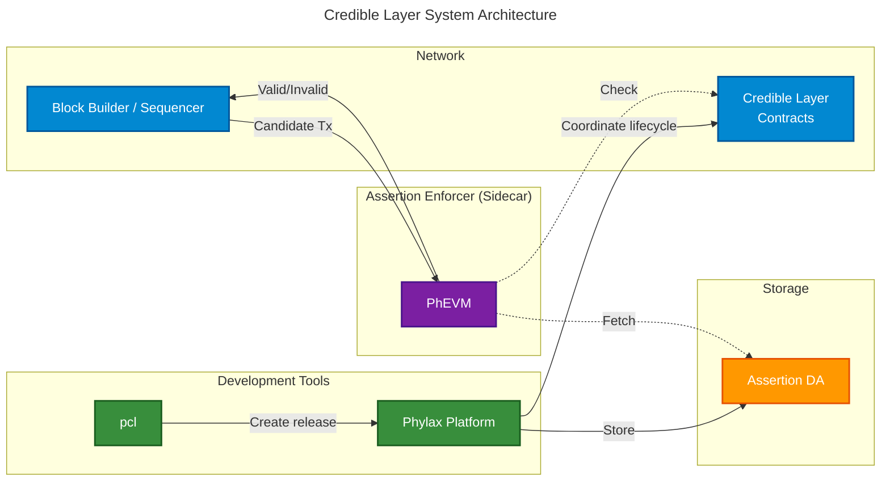
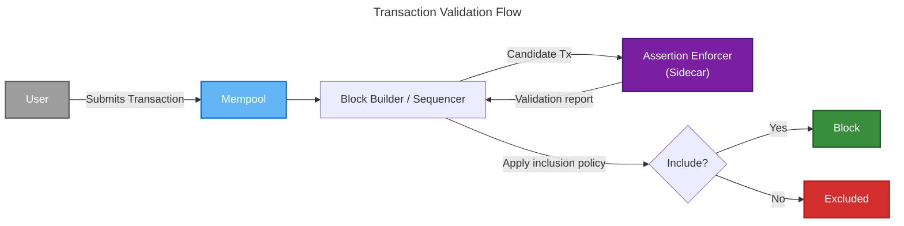
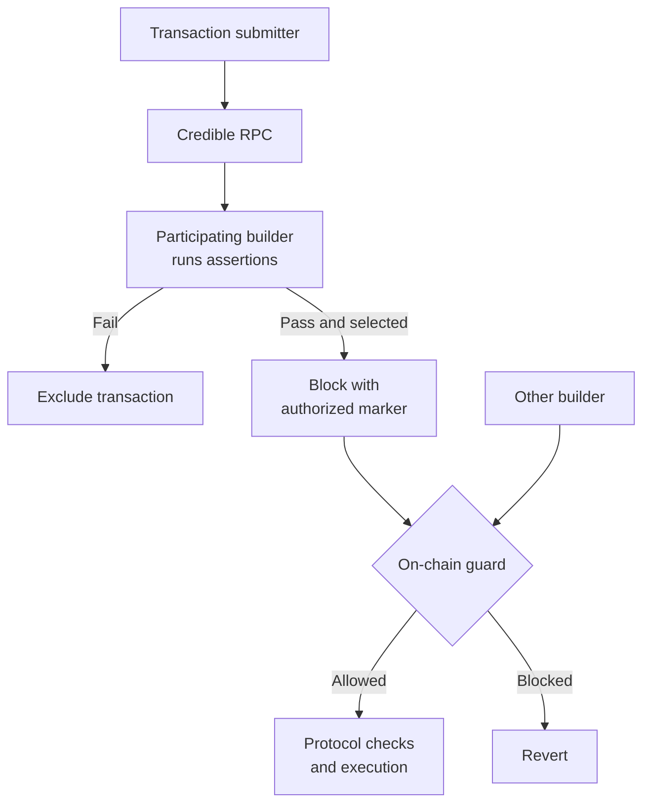
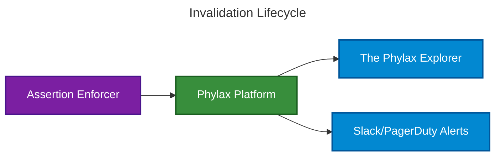

This page provides an overview of the Credible Layer architecture, how the components fit together and interact to enforce security rules for smart contracts.

<Note>
Looking for a non-technical introduction? Start with the [Credible Layer Overview](/credible/credible-layer-overview).
</Note>

## System Overview

The Credible Layer consists of four core components:

1. **[Assertions](/credible/assertions-overview)**: Security rules written in Solidity that define states that should never occur
2. **[Assertion Enforcer](/credible/assertion-enforcer)**: Sidecar that validates transactions against assertions during block production
3. **[Credible Layer Contracts](/credible/credible-layer-contracts)**: The State Oracle records assertion assignments and lifecycle state; decentralized-builder integrations also use a Credible Registry for block markers
4. **[Assertion DA](/credible/assertion-da)**: Storage layer for assertion bytecode and source code

## How the Credible Layer Works

The Credible Layer validates candidate transactions against protocol-defined assertions during block building. Its sidecar runs alongside a participating sequencer or builder. The enforcement boundary and transaction sources covered depend on the network integration.

An integrated sequencer can apply validation at its inclusion boundary. On networks with decentralized builders, participating builders run the enforcer, while on-chain guards restrict protected operations to credible blocks. This introduces builder, Registry, and guard assumptions described in the [Trust Model](./trust-model).

### System Architecture

The diagram shows two main flows:

**Development Flow**: Developers use [`pcl`](/credible/apply-assertions) to develop, test, and prepare assertions for deployment. Running `pcl apply` compiles assertion code and creates a release on the [Phylax platform](https://app.phylax.systems), which handles storing it in [Assertion DA](/credible/assertion-da). A separate on-chain lifecycle action through the deployment flow schedules activation of the release through the [Credible Layer Contracts](/credible/credible-layer-contracts).

**Runtime Flow**: The block builder or sequencer sends transactions to the [Assertion Enforcer](/credible/assertion-enforcer) during block production. The enforcer uses its registry snapshot (from on-chain events) and cached assertion bytecode (from [Assertion DA](/credible/assertion-da)) to execute relevant assertions via [PhEVM](/credible/phevm). The network integration applies its inclusion policy to the resulting validation report.

### How It Works

1. **Assertion Release and Activation**: Developers write assertions and create a release with `pcl apply`. The platform stores the artifact in Assertion DA; a separate on-chain lifecycle action activates it
2. **Transaction Validation**: The network sends transactions to the Assertion Enforcer during block production
3. **Assertion Execution**: The Assertion Enforcer simulates each transaction and validates it against relevant assertions using PhEVM
4. **Validation Results**: The Assertion Enforcer returns valid/invalid results to the block builder or sequencer
5. **Network Policy**: The network integration uses the validation result when deciding whether to include the transaction

## Transaction Flow

The following diagram shows validation at a participating sequencer or builder. Submission can arrive through a mempool or the integration’s routing endpoint:

1. **Transaction Submission**: User submits a transaction to the network
2. **Mempool Entry**: Transaction enters the mempool awaiting selection
3. **Block Builder Selection**: The block builder picks transactions from the mempool
4. **Assertion Validation**: Candidate transactions are validated against applicable active assertions
5. **Inclusion Decision**: The network applies its inclusion policy to the validation report

<Note>
The Assertion Enforcer is integrated with the block builder. During block production, the block builder invokes the Assertion Enforcer to validate transactions before including them.
</Note>

## Decentralized Block Building

A network can have builders that do not run the Assertion Enforcer. Routing transactions to participating builders helps them reach the enforcement path, but routing alone cannot prevent inclusion elsewhere. The integration therefore combines off-chain validation with an on-chain gate.

The guard allows a credible block, an active fail-open condition, or an authorized bypass. Otherwise it rejects the protected operation.

The authorized builder records the marker in the **Credible Registry** before protected operations execute. The marker is bound to the expected block timestamp. A guard consults the Registry to check the current block; it does not re-run assertions or verify a proof of their execution.

The **State Oracle** has a separate role: it records assertion assignments, Protocol Managers, and lifecycle timing. Registering assertions there neither installs a guard nor changes RPC routing.

### Guard Coverage and Routing

Every execution path in the protected scope must reach a suitable gate. This can require a protocol upgrade, a supported wallet guard, or an existing hook. A Safe transaction guard covers owner-authorized execution; module paths need separate controls or a downstream gate. Internal calls and alternative entry points must be included in the coverage review.

The actual top-level submitter uses the Credible RPC: for example, the wallet, multisig executor, keeper, or relayer. A contract making an internal call cannot choose an RPC. Reads and unprotected traffic can continue using ordinary providers.

### Exclusion, Reverts, and Availability

A builder exclusion happens before inclusion and consumes no on-chain execution gas. A transaction included in a noncredible block can instead revert at the guard and consume gas. Passing assertions does not guarantee that a builder will include a transaction.

Guards can permit operations after a configured gap in credible blocks or through an authorized bypass. Fail-open relaxes the requirement for a credible block; participating builders may still run assertions. Registry-error handling differs between guard implementations. See the [FAQ](./faq#availability-false-positives-and-recovery) for recovery behavior and the [Trust Model](./trust-model) for assumptions.

## Invalidation Lifecycle (Public View)

Invalidations are recorded for project review and configured alerts. Public views expose selected posture information; private transaction payloads and traces are not automatically public.

## Integration Paths

<CardGroup cols={2}>
  <Card title="Plan a Platform Integration" icon="browser" href="/credible/dapp-integration">
    How protocols deploy and manage assertions
  </Card>
  <Card title="Network Integration Overview" icon="sitemap" href="/credible/network-integration">
    How networks and sequencers integrate enforcement
  </Card>
  <Card title="Interface Overview" icon="diagram-project" href="/credible/interfaces-overview">
    High-level component boundaries and dependencies
  </Card>
</CardGroup>

For details on the assertion validation process, see [Assertion Enforcer](/credible/assertion-enforcer#validation-process).

## System Components

### Assertion Enforcer

The [Assertion Enforcer](/credible/assertion-enforcer) is a sidecar that orchestrates transaction validation. It identifies which assertions apply to incoming transactions and invokes PhEVM to execute them. The network integration applies its inclusion policy to the resulting validation report.

### PhEVM (Phylax EVM)

[PhEVM](/credible/phevm) is the execution engine that runs assertion bytecode. It extends the standard EVM with [cheatcodes](/credible/glossary#cheatcodes) for state inspection, enabling assertions to compare pre-transaction and post-transaction states.

### Assertion DA

[Assertion Data Availability](/credible/assertion-da) stores assertion bytecode and source code, making them accessible to Assertion Enforcers and providing transparency for users and auditors.

### Credible Layer Contracts

The [Credible Layer Contracts](/credible/credible-layer-contracts) manage assertion lifecycle state through the State Oracle. Decentralized-builder integrations also use a Credible Registry to authorize block markers. These are separate responsibilities; see [Decentralized Block Building](#decentralized-block-building).

### Developer Tools

- **[Phylax platform](https://app.phylax.systems)**: Web interface for deploying, managing, and viewing assertions
- **[`pcl`](/credible/apply-assertions)**: Command-line tool for writing, testing, and deploying assertions
- **[`credible-std`](/credible/credible-std-overview)**: Standard library exposing cheatcodes and testing utilities

## Network Integrations

The Credible Layer can be implemented on different networks. The core concepts remain the same, but implementation details vary by network architecture.

For specific implementation details, see:
- [OP Stack Implementation](/credible/network-integrations/architecture-op-stack)

---

For concrete assertion examples and real-world use cases, explore the [Assertions Book](/assertions-book/assertions-book-intro).

## Next Steps

<CardGroup cols={2}>
  <Card title="Quickstart Guide" icon="rocket" href="/credible/pcl-quickstart">
    Write and deploy your first assertion
  </Card>
  <Card title="Installation" icon="download" href="/credible/credible-install">
    Set up your development environment
  </Card>
  <Card title="Assertion Guide" icon="code" href="/credible/write-first-assertion">
    Comprehensive guide to writing assertions
  </Card>
  <Card title="Cheatcodes Reference" icon="book" href="/credible/cheatcodes-reference">
    Detailed reference for assertion functions
  </Card>
  <Card title="Trust Model" icon="shield-check" href="/credible/trust-model">
    Guarantees, scope, and operational model
  </Card>
</CardGroup>
