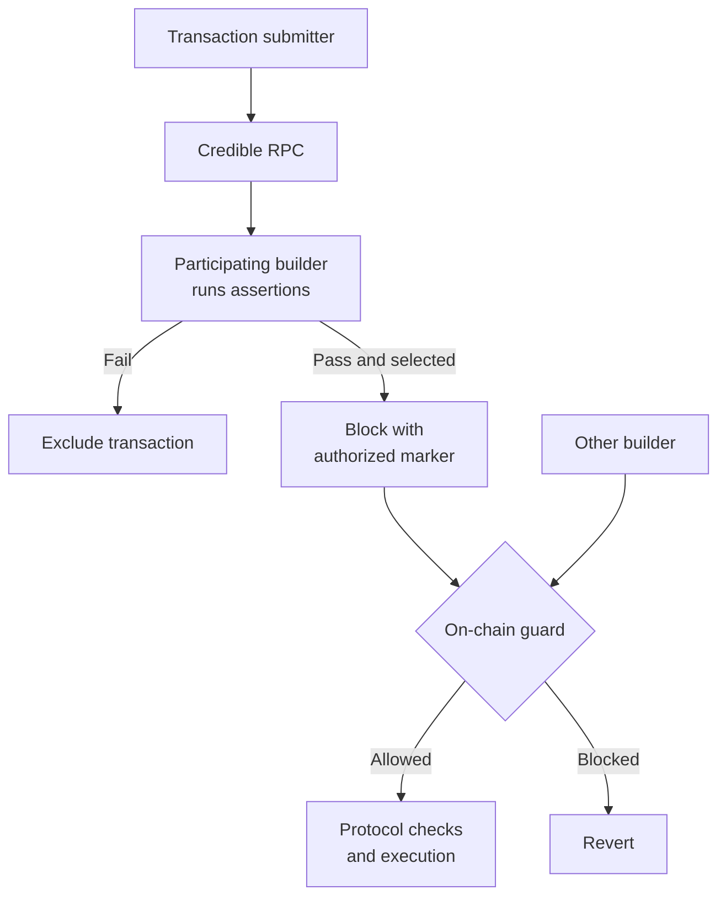
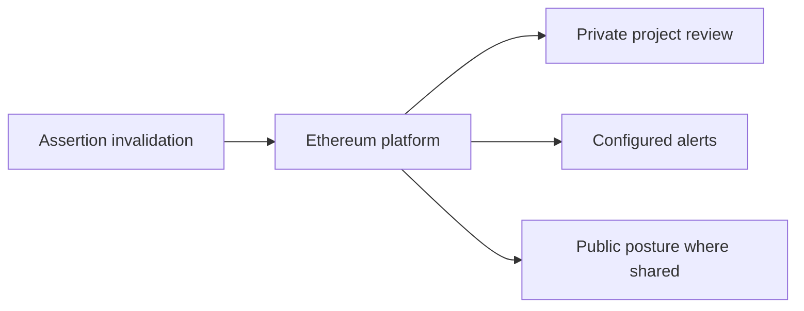

On Ethereum, the Credible Layer combines off-chain assertion validation by participating builders with an on-chain guard on protected operations. The Credible RPC routes submissions to those builders. Ethereum validators do not independently execute Phylax assertions as part of consensus.

For a shorter introduction, see [How Ethereum Enforcement Works](./credible-layer-overview). The earlier sequencer model is documented separately under [L2 and Sequencer Integrations](./l2-integrations/overview).

## System Overview

| Component | Role |
| --- | --- |
| Assertions | Solidity rules and triggers that describe the transaction effects a protocol permits. |
| State Oracle | Records assertion assignments, Protocol Manager authority, and activation or removal timing. |
| Assertion DA | Supplies assertion bytecode and source artifacts. |
| Assertion Enforcer / PhEVM | Evaluates applicable assertions against candidate transaction execution state. |
| Participating builder | Uses validation reports to exclude failing candidates and marks the blocks it builds under that policy. |
| Credible Registry | Authorizes builders and records credible-block markers. |
| Contract or wallet guard | Restricts protected operations to credible blocks while its gate is active. |
| Credible RPC | Routes top-level transaction submissions to participating builders. |

The State Oracle and Credible Registry have different jobs. Registering an assertion does not install a guard, authorize a builder, or configure a wallet's submission route.

## How the Credible Layer Works

### Release and Activation

Developers write and test assertions, then create a release with [`pcl apply`](./apply-assertions). The [Ethereum platform](https://ethereum.phylax.systems) coordinates artifacts and release review. An authorized Protocol Manager signs the lifecycle action; the State Oracle determines when it takes effect.

The enforcer indexes lifecycle events and prepares the active assertion bytecode in its cache. Creating a release or passing backtesting is not production activation.

### Validation During Block Building

A participating builder supplies candidate transaction context to the [Assertion Enforcer](./assertion-enforcer). [PhEVM](./phevm) evaluates the assertions whose triggers match, using transaction and call snapshots where needed.

The enforcer returns a validation report. The builder excludes a candidate that fails active production rules. Passing assertions makes the candidate eligible for inclusion; it does not guarantee selection, ordering, or finality. A failure means a rule was violated, which can also happen to legitimate activity under a restrictive rule.

## Transaction Flow

The guard allows execution in a credible block, or when its configured fail-open or authorized bypass condition applies. Otherwise it rejects the protected operation. Ordinary protocol authorization and accounting checks still run.

## Decentralized Block Building

Ethereum has builders that do not run the Assertion Enforcer. Sending through the Credible RPC helps a transaction reach participating builders, but routing alone cannot prevent inclusion elsewhere. An unavoidable on-chain gate supplies the restriction on protected execution paths.

The authorized builder places a marker transaction before protected operations execute. The marker is bound to the expected block timestamp and updates the **Credible Registry**. The guard checks that marker; it does not re-run assertions or verify a cryptographic proof of their execution.

The design therefore relies on authorized builder behavior, marker publication assumptions, Registry administration, and correct guard coverage. See [Trust Model](./trust-model).

### Guard Coverage and Routing

Every path in the protected scope must reach a suitable gate. This can require a protocol upgrade, a supported wallet guard, or an existing hook. A Safe transaction guard covers owner-authorized execution; module paths need separate controls or an unavoidable downstream gate.

Configure the actual top-level submitter to use the Credible RPC: the wallet, Safe executor, keeper, bot, or relayer. Off-chain signers and internally called contracts do not choose that route. Reads and unprotected traffic can continue using ordinary providers.

### Exclusion, Reverts, and Availability

A builder exclusion happens before inclusion and consumes no on-chain execution gas. An included transaction can instead revert at an on-chain guard and consume gas. A transaction timeout alone does not distinguish these outcomes from ordinary inclusion delays.

A configured gap in credible blocks or an authorized bypass can relax a guard's requirement. During fail-open, operations may execute through nonparticipating builders; participating builders can continue enforcing assertions. Registry-error behavior differs between guard implementations.

A restrictive assertion can block legitimate operations even while credible blocks continue to be produced. A block-gap fallback is therefore not a universal recovery mechanism. See the [FAQ](./faq#availability-false-positives-and-recovery).

## Invalidation Lifecycle (Public View)

The integration reports assertion invalidations to the platform for project review and configured alerts. Public views expose selected posture information; transaction payloads, traces, and staging records are not automatically public.

An invalidation report, an on-chain guard revert, and a submission failure are separate events. Operators should reconcile them using the transaction status, assertion result, and contract state.

## System Components

- [Assertion Enforcer](./assertion-enforcer): validation, resource limits, and artifact caching.
- [PhEVM](./phevm): execution and state inspection for assertions.
- [Assertion DA](./assertion-da): assertion artifacts and availability.
- [Credible Layer Contracts](./credible-layer-contracts): State Oracle, Credible Registry, guards, and authority.
- [Interface Overview](./interfaces-overview): the boundaries between these components.

## Integration Paths

- [Protocol teams](./dapp-integration): scope assertions, guards, routing, and recovery.
- [Ethereum builders](./ethereum-builder-integration): connect validation, marking, and operations.
- [L2 and sequencer operators](./l2-integrations/overview): separate network integration designs.
