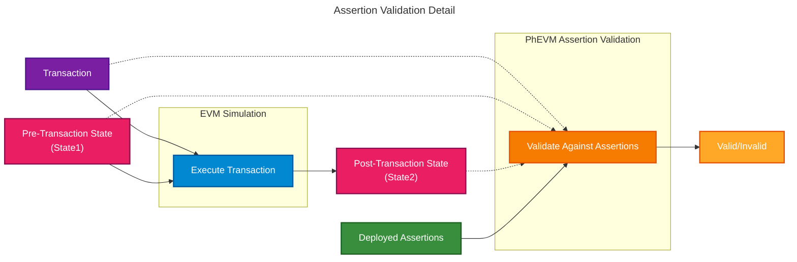

The Assertion Enforcer validates candidate transactions for participating Ethereum builders. It runs [assertions](./assertions-overview) through [PhEVM](./phevm) and reports failures to the builder.

## Role in the System

The enforcer selects applicable assertions, executes them, and returns validation reports. The builder applies the results before publishing its block.

Sequencer-specific execution and rollback designs are covered in [L2 Validation Pipelines](./l2-integrations/validation-pipeline).

## Sidecar Architecture

The enforcer runs beside the builder and scales independently. It requires a builder validation hook. Protocol protection also requires guards and transaction routing.

## Validation Process

The validation process:

### Step-by-Step

1. Read indexed State Oracle data to identify assertions for the affected contracts.
2. Load their bytecode from the local cache.
3. Execute the transaction to obtain its state snapshots.
4. Run the matching assertions in PhEVM.
5. Return assertion results to the builder.

## Block Building Integration

The builder excludes candidates that fail active production assertions. Passing validation does not guarantee inclusion.

### Invalidation Handling

The integration reports failures to the platform. Other builders do not inherit this decision. The onchain guard restricts protected operations in their blocks.

## Performance Model

Measure assertion execution against the builder's block-production budget. Monitor trigger frequency, tail latency, worker backlog, and rejected candidates.

Prepare bytecode before validation. Define how timeouts, execution errors, and missing artifacts affect inclusion.

## Production Admission and Resource Limits

Review each assertion before admitting it to production. Check its trigger scope, frequency, runtime, read footprint, and deterministic behavior. Review backtesting and alerting results.

Assertions execute read-only. Scoped triggers and bounded execution limit their cost.

## Resource Isolation and Griefing Controls

Use dedicated worker capacity and explicit execution limits. Publishing an assertion does not grant it production resources.

Ingress filters can suppress repeated invalid submissions through short-lived fingerprints. Use conservative thresholds and expiry times for fingerprints that group different transactions.

## Operational Expectations (Public)

Validation is deterministic for the same state, transaction, and assertion code. Alerting records results without production exclusion. Project permissions control access to invalidation details.

## Assertion Caching

The enforcer detects assertion registration events and fetches bytecode from [Assertion DA](./assertion-da). Validation reads this local cache without fetching artifacts from the network.

## Learn More

<CardGroup cols={2}>
  <Card title="For Ethereum Builders" icon="sitemap" href="./ethereum-builder-integration">
    Plan validation, marking, and builder operations
  </Card>
  <Card title="Trust Model" icon="shield-check" href="/credible/trust-model">
    Guarantees, scope, and operational model
  </Card>
</CardGroup>
