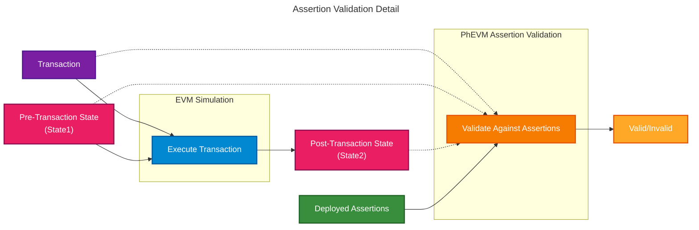

The Assertion Enforcer is a sidecar component that validates transactions against [assertions](/credible/glossary#assertion) during block production. On Ethereum it operates alongside a participating [block builder](./glossary#block-builder), reporting which candidate transactions violate active assertions. The builder applies those reports; the enforcer does not replace the protocol's on-chain guard.

## Role in the System

The Assertion Enforcer operates inside the block production pipeline:

1. Receives candidate transactions from the participating Ethereum builder
2. Identifies which assertions apply to each transaction
3. Invokes [PhEVM](/credible/phevm) to execute assertions against transaction states
4. Returns validation results to the network
5. The network integration applies its inclusion policy to those results

The builder must apply the required validation results before publishing its candidate block. Sequencer-specific speculative execution and rollback designs are covered in [L2 Validation Pipelines](./l2-integrations/validation-pipeline).

## Sidecar Architecture

As a [sidecar](/credible/glossary#sidecar), the Assertion Enforcer:

- **Runs alongside the builder** as a separate assertion-execution component
- **Integrates alongside block builders** without changing core protocol rules
- **Scales separately** from the main network components
- **Preserves network continuity** by keeping block production policy under the network operator's integration

The integration requires a builder validation hook. Ethereum protocol protection additionally requires guard coverage and transaction routing; running a sidecar alone does not supply either.

## Validation Process

When a transaction arrives for validation, the Assertion Enforcer orchestrates the following process:

### Step-by-Step

1. **Identify Relevant Assertions**: The Assertion Enforcer consults State Oracle data (indexed from [on-chain events](/credible/credible-layer-contracts)) to find which assertions apply to the contracts the transaction interacts with

2. **Fetch Assertion Bytecode**: Assertion bytecode is retrieved from internal cache (populated from [Assertion DA](/credible/assertion-da) when assertions are deployed)

3. **Simulate Transaction**: The transaction is executed against pre-transaction state to produce the post-transaction state

4. **Execute Assertions**: [PhEVM](/credible/phevm) runs all relevant assertions with access to:
   - The transaction itself
   - Pre-transaction state (State1)
   - Post-transaction state (State2)

5. **Return Result**:
   - If any assertion reverts → transaction is invalid
   - If all assertions pass → transaction is valid

## Block Building Integration

Participating Ethereum builders use validation reports before publishing their candidate blocks:

- The participating Ethereum builder receives validation results for candidate transactions
- Active production assertion failures exclude the candidate at that builder
- Passing validation makes a candidate eligible for inclusion; it does not guarantee selection

### Invalidation Handling

When an active production assertion invalidates a candidate, the participating builder excludes it and the integration reports the invalidation to the platform. Other builders do not inherit this decision; the on-chain guard supplies the restriction on protected execution paths.

## Performance Model

Measure assertion workload within the participating builder's block-production budget. Use scoped triggers, bounded execution, prepared artifacts, and monitored worker capacity. Define the treatment of errors, timeouts, and missing artifacts before production.

Assertion bytecode is prepared in local caches so validation does not depend on live artifact retrieval. Monitor trigger frequency, tail latency, backlog, and rejected candidates. Parallel execution does not imply a fixed latency or zero overhead.

[L2 Validation Pipelines](./l2-integrations/validation-pipeline) describe the separate speculative-execution, rollback, and ingress-control designs.

## Production Admission and Resource Limits

Production execution uses the active assertion set admitted through the configured registry and review process.

Production assertion admission should account for:

- Protected protocol areas and trigger conditions
- Expected trigger frequency
- Maximum gas or runtime budget
- Expected read footprint
- Deterministic behavior and read-only execution
- Platform release-backtesting and staging behavior
- Suitability for common acceleration paths, such as compact trace summaries or native helper functions

These controls keep block-building resources predictable and help protocol teams understand which assertions are ready to promote from staging to production.

## Resource Isolation and Griefing Controls

Assertions should not automatically consume production block-building resources just because they were published. Production admission and resource limits protect the network from broad, expensive, or poorly scoped assertions.

Common controls include:

- Authorization or review before an assertion enters the production execution set
- Trigger scoping so assertions run only for relevant contracts, selectors, or state changes
- Runtime and read-footprint limits
- Dedicated worker capacity for assertion execution
- Timeout behavior with clear inclusion-policy consequences
- Staging and platform release-review requirements before production promotion

Ingress filtering can also reduce repeated invalid submissions. When a transaction invalidates, the integration can record short-lived fingerprints for exact replays or repeated attempts against the same assertion and target contract or function. Broad fingerprints should use conservative TTLs and thresholds.

## Operational Expectations (Public)

- **Non-invasive**: Runs alongside existing block builders without changing consensus rules
- **Deterministic**: Given the same state, transaction, and assertion code, validation results are deterministic
- **Staging support**: Networks can validate assertions before enforcing them in production
- **Observable outcomes**: Project invalidations are available to authorized members; public Explorer views expose selected information

## Assertion Caching

To ensure high-performance validation, the Assertion Enforcer maintains an internal cache of assertion bytecode:

- **On deployment**: When an assertion is deployed on-chain, the Assertion Enforcer detects the event and fetches bytecode from [Assertion DA](/credible/assertion-da)
- **During validation**: Assertions are loaded from cache. No network requests occur on the hot path.

This caching strategy keeps assertion data retrieval out of the block-production hot path.

## Learn More

<CardGroup cols={2}>
  <Card title="Ethereum Builder Integration" icon="sitemap" href="./ethereum-builder-integration">
    Plan validation, marking, and builder operations
  </Card>
  <Card title="Trust Model" icon="shield-check" href="/credible/trust-model">
    Guarantees, scope, and operational model
  </Card>
</CardGroup>
