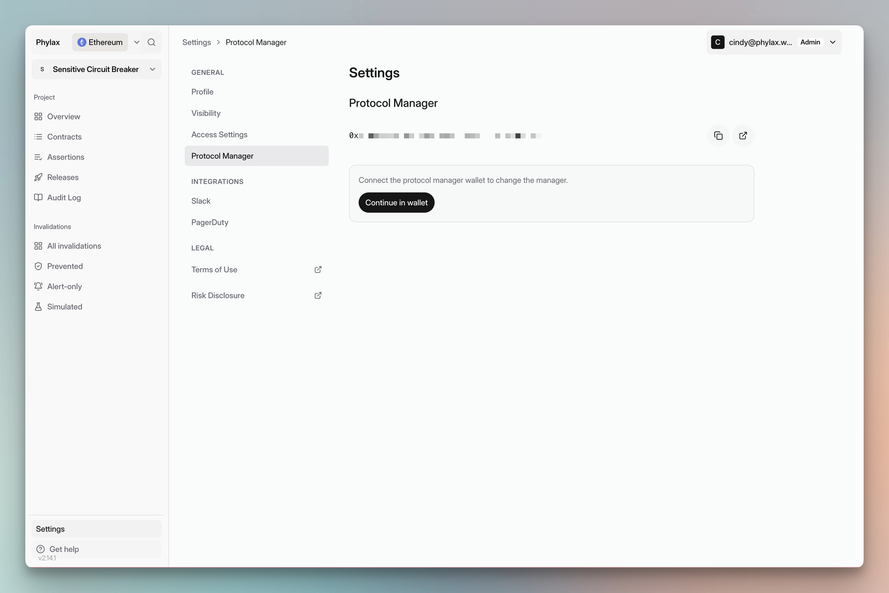

Assign a Protocol Manager wallet to sign releases that deploy, update, or remove your circuit breakers. Your team controls this wallet and its signing policy. Do not hold funds in it.

## Choose the signing account

Use dedicated keys that are entirely independent of the keys used to manage any other component of your business. We recommend a multisig wallet with a diversified signer set. Choose its signers and threshold before setup.

Some customers prefer to gate deployments with hardware. Phylax can help you set this up.

When using a Safe, assign the Safe address as Protocol Manager, not an individual owner's address. Connect through the Safe so signatures represent the multisig.

Your FDE helps define, implement, and test policies. Policy approval and control of your protocol remain your team's authority.

## Assign the wallet

Sign in to the [Phylax platform](https://ethereum.phylax.systems) as a project admin.

1. Open your project and expand **Set protocol manager** in the setup checklist.
2. Select **Continue in wallet** and connect the account you chose. If a wallet is already connected, check its address before selecting **Use connected wallet**; select **Connect another wallet** to change it.
3. Review and sign the wallet-verification message. Complete the required multisig approvals if you use a Safe.
4. Open **Settings → Protocol Manager** and confirm that the full address matches your chosen account.

<Frame caption="Check the assigned address under Settings → Protocol Manager">
  
</Frame>

This setup verifies the wallet and records it for the project. See [Managing Policy Deployments](./managing-policy-deployments) for deployment authority and timing.

## Sign and deploy circuit breakers

Open a release and [review its policies and checks](./managing-your-circuit-breakers#review-a-release). Connect the assigned Protocol Manager, confirm the environment, and authorize deployment. For a Safe, collect the required approvals and execute the transaction through the Safe.

Wait for the configured activation delay, then check the active policies. See [Review and Deploy Policies](./deploy-assertions-dapp#step-5-authorize-deployment) for the deployment steps.

## Change an existing manager

Open **Settings → Protocol Manager** and connect the current manager. Enter the **New manager address**, select **Change Protocol Manager**, and approve the change.

For active contracts, the new manager must connect and **Accept manager transfer** before the transfer takes effect. Confirm that the pending transfer is complete and the new address is displayed before using it to deploy releases.
