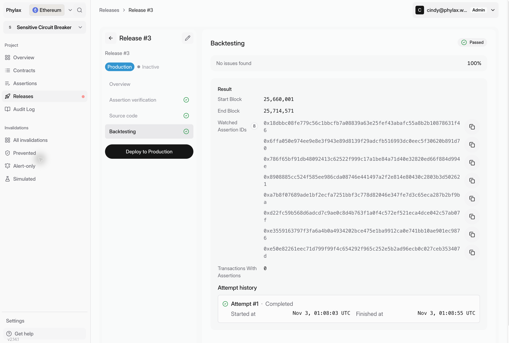
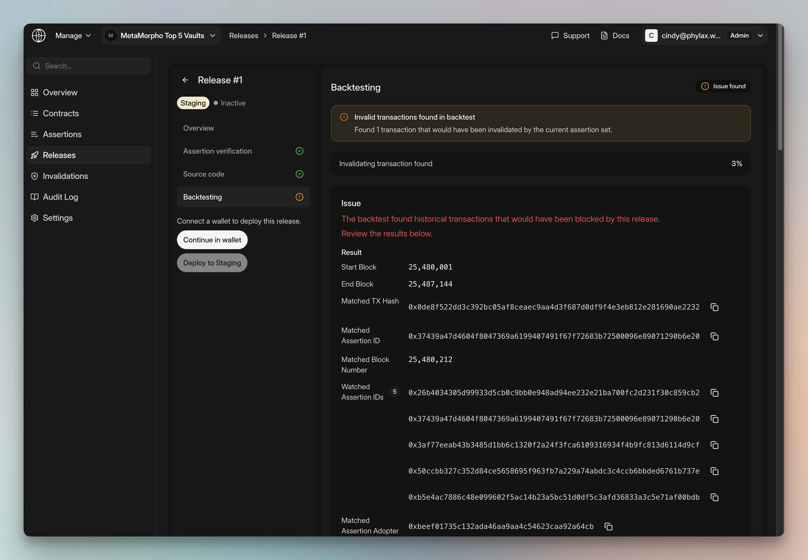
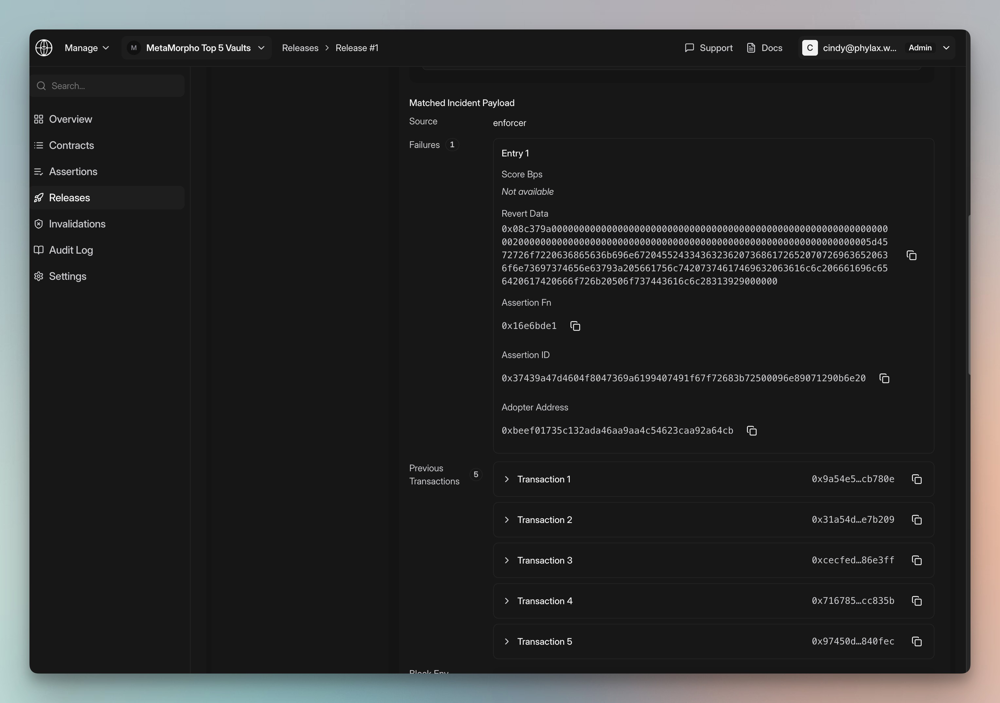

Review a release backtest to find policy violations in historical transactions and investigate false positives.

**Prerequisites**:

- A project in the Phylax platform
- A release created with [`pcl apply`](./apply-assertions)
- Access to review that project's releases

## What backtesting checks

The platform evaluates release assertions against a historical block range. Findings identify transactions that would violate the proposed rules. Use the block range reported by the backtest to assess its coverage.

Use the results to check policy behavior against real activity. A passing result does not cover untested operations or future exploits.

## Open the release

Open your project and select the release under **Releases**. Review its proposed changes and [release checks](./deploy-assertions-dapp#step-4-review-release-checks).

Select **Backtesting** and check the block range, watched assertion IDs, and **Transactions With Assertions**. **Passed** reports no violations in the tested activity. **Issue found** means a transaction needs review.

<Frame caption="This backtest passed, but zero transactions exercised its assertions">
  
</Frame>

A zero count does not demonstrate that the policies allow intended behavior or reject violations. Exercise those cases in your [local and integration tests](./testing-strategy) before deployment.

## Review a backtesting finding

For a finding, check **Matched TX Hash**, **Matched Assertion ID**, and **Matched Assertion Adopter**. These identify the transaction, failed rule, and protected contract. The result also shows the block number and check history.

<Frame caption="A backtesting finding with the matched transaction, assertion, block, and adopter">
  
</Frame>

## Inspect the invalidated transaction

Open **Matched TX Hash** in the network's block explorer. Compare the transaction's calls and state changes with the intended policy. Determine whether the activity should be permitted.

Inspect **Matched Incident Payload** to map the revert data to the assertion function and adopter. For policies with historical context, inspect previous transactions and the block environment. Earlier activity can explain a threshold violation.

<Frame caption="Use the incident payload and preceding transactions to understand why the assertion failed">
  
</Frame>

## Decide what to do next

- **Expected violation:** record why the policy should reject it, then review the remaining release checks.
- **False positive:** revise the policy and add a regression test. Create a new release with `pcl apply` to repeat the checks.
- **Unexplained result:** investigate the payload and replay context before deployment. See [Troubleshooting](./troubleshooting).

After review, deploy to alerting and follow the [testing strategy](./testing-strategy).

## Next steps

<CardGroup cols={2}>
  <Card title="Test Assertions" icon="flask" href="./testing-assertions">
    Add focused and regression tests before creating another release
  </Card>
  <Card title="Apply Assertions" icon="code-branch" href="./apply-assertions">
    Create a new release after tuning an assertion
  </Card>
  <Card title="Review and Deploy Policies" icon="rocket" href="./deploy-assertions-dapp">
    Review release checks and authorize deployment.
  </Card>
</CardGroup>
