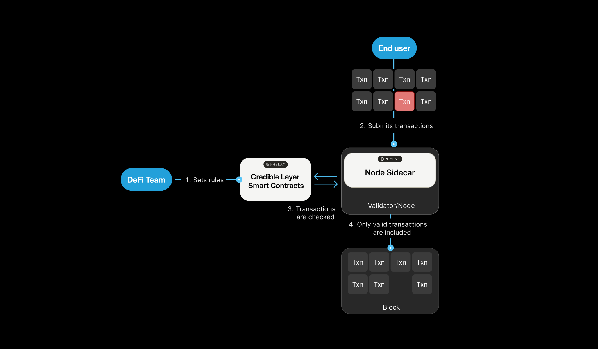
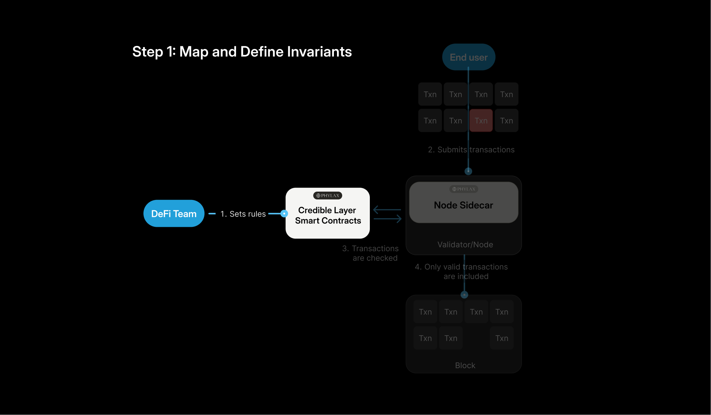
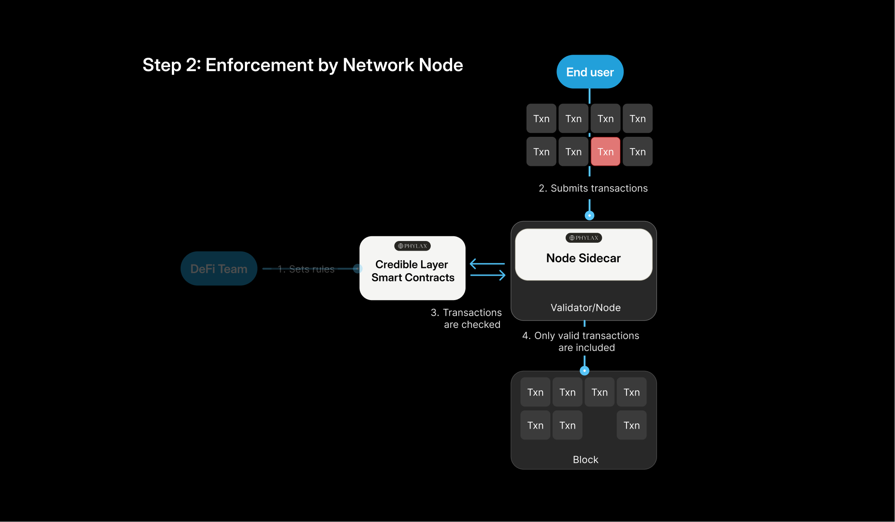
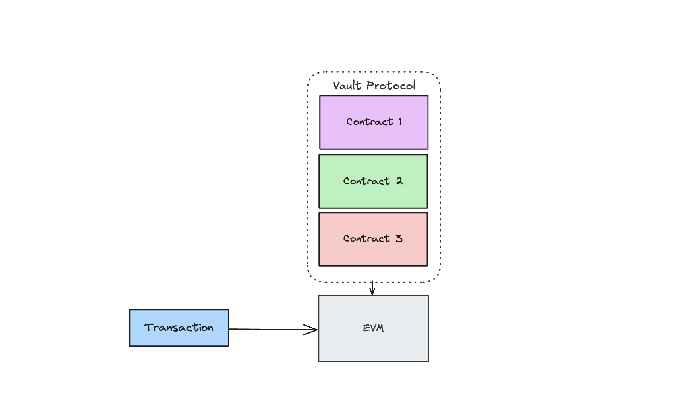
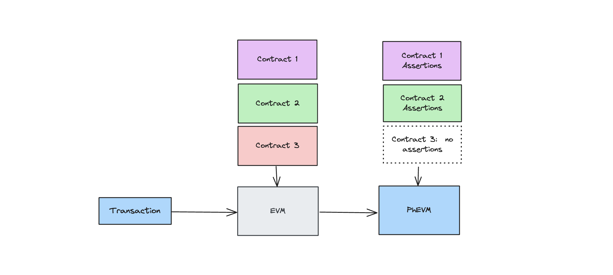

This explanation describes how assertions influence transaction inclusion and how enforcement differs between an integrated sequencer and a network with decentralized block building.

## Introduction

The Credible Layer lets protocols define rules for transaction effects and enforce those rules during block building. Its protection is bounded by the rules and execution paths covered by the integration.

This illustration shows validation at a participating node. Decentralized-builder deployments also require the guard path described below.

<Info>
**The Credible Layer** checks candidate transactions before inclusion. Participating sequencers or builders exclude transactions that violate active assertions. Decentralized-builder integrations also need an on-chain gate so protected operations cannot simply execute through a nonparticipating builder.
</Info>

At a glance:

- **Security rules** are defined by the protocol team as [assertions](/credible/glossary#assertion), with assertion IDs registered on-chain and bytecode served through [Assertion DA](/credible/assertion-da)
- **Participating sequencers or builders** validate candidate transactions against relevant active assertions
- **Invalidating transactions** are [dropped](/credible/glossary#drop) by the enforcing integration; guards restrict protected execution paths on decentralized-builder networks

<Check>
**Easy to adopt**
- Written in Solidity with familiar Forge patterns
- Assertion policy is maintained separately from protocol code
- Contract changes, guards, and transaction routing depend on the enforcement model
- All rules are publicly reviewable in [The Phylax Explorer](/credible/glossary#the-phylax-explorer)
- [Implementation effort](/credible/development-effort) includes testing, authorization, and integration of protected paths
</Check>

## Use Cases

Assertions enable a wide range of security and compliance use cases:

<CardGroup cols={2}>
  <Card title="Parameter Protection" icon="shield-halved">
    Prevent unauthorized changes to critical protocol parameters such as owner and implementation addresses
  </Card>
  <Card title="Market Integrity" icon="chart-line">
    Ensure market prices don't move beyond specified thresholds inside of a single transaction
  </Card>
  <Card title="Lending Protocol Safety" icon="building-columns">
    Check lending positions against defined collateralization rules
  </Card>
  <Card title="Oracle Monitoring" icon="satellite-dish">
    Verify oracle prices stay within specified ranges to detect price manipulation
  </Card>
  <Card title="Balance Invariants" icon="scale-balanced">
    Ensure that the sum of all positions match the total balance of a protocol
  </Card>
  <Card title="Compliance Rules" icon="clipboard-check">
    Enforce KYC/AML requirements by validating that transaction participants meet regulatory criteria
  </Card>
</CardGroup>

For concrete examples and implementations, explore the [Assertions Book](/assertions-book/assertions-book-intro).

## Who It's For

<CardGroup cols={2}>
  <Card title="Protocol Teams" icon="code" href="/credible/dapp-integration">
    Deploy and manage assertions to protect your contracts
  </Card>
  <Card title="Networks & Sequencers" icon="sitemap" href="/credible/network-integration">
    Integrate enforcement into block building
  </Card>
</CardGroup>

## How It Works

### Defining Security Rules

Security rules (technically called [invariants](/credible/glossary#protocol-invariants)) are statements about your contract that must remain true no matter how users interact with it. They express the essential conditions that keep your system secure and functional.

Instead of exhaustively predicting every exploit path, you define the _states that must never occur_. If one of these states is violated, something fundamental has gone wrong.

These rules are then implemented as [assertions](/credible/glossary#assertion), which are Solidity smart contracts that verify the rules hold true. For a deeper understanding of how assertions work, see the [Assertions Overview](/credible/assertions-overview).

**Beyond Security Rules**

While invariants are the most common use case, assertions also enable:
- **Timelocks and Access Control**: Add time-based restrictions or multi-factor authentication requirements for sensitive functions like contract upgrades
- **Business Logic Enforcement**: Ensure operational rules are followed, such as transaction limits or authorized contract interactions

### Example: Detecting Unexpected State Changes

An assertion can compare a pool's state before and after a transaction and reject a change outside its defined bounds. This can detect a harmful effect without identifying every possible exploit path. The bounds still need testing against legitimate activity.

The [Balancer V2 case study](../assertions-book/previous-hacks/balancer-v2-stable-rate-exploit) shows this approach with an exploit replay. A successful replay demonstrates that a rule detects that transaction under the test conditions; production protection also depends on active rules and enforcement coverage.

### Network Enforcement

Once assertions are defined, they need to be deployed to protect your contracts. This involves submitting the assertion to your project, then linking it to your contract address.

The [Phylax platform](https://app.phylax.systems) creates releases and submits assertion changes to the Credible Layer smart contracts. Those contracts are the source of truth for which assertion IDs protect which contract addresses and when changes become active. Assertion bytecode is stored in [Assertion DA](/credible/assertion-da) and fetched by the enforcer before validation.

#### How Enforcement Works

A participating sequencer or builder invokes the Credible Layer [sidecar](/credible/glossary#sidecar) to evaluate relevant assertions. An assertion failure reports a rule violation; the enforcing integration excludes the candidate transaction. A rule violation can also reflect a false positive, so rules need review and testing.

When a user opens a position on a yield protocol, the transaction may touch multiple contracts:

Each contract that has assertions is checked by the sidecar, which simulates the cumulative end states:

#### Validation Process

1. User submits a transaction to the network
2. The network node passes it to the sidecar for validation
3. The sidecar simulates the transaction and checks all relevant assertions
4. If all assertions pass, the transaction remains eligible for inclusion, subject to normal validity and builder selection
5. If any active production assertion fails, the enforcing integration excludes the transaction

The validation path is designed to keep assertion lookup and execution bounded for each network integration. The Credible Layer adapts to each network's architecture while preserving the same core model: protocol-authored assertions inform the block inclusion decision.

### Decentralized Builders and Contract Guards

When only some builders participate, assertion validation is not a chain-wide consensus rule. A protected operation needs an on-chain guard that checks whether the current block was marked credible by an authorized builder. The Credible RPC routes submissions to those builders; the guard rejects protected operations in other blocks while its gate is active.

The marker is a builder attestation, not a proof of assertion execution. A configured fail-open condition or authorized bypass can relax the gate. Those choices affect both availability and protection and belong in the integration's [Trust Model](./trust-model).

This may require contract changes or a supported wallet guard. Registering assertions alone does not protect an immutable contract with no suitable enforcement gate.

For the full flow, see [Architecture](./architecture-overview). The [FAQ](./faq) covers routing, batching, false positives, and recovery.

<Note>
The Credible Layer is designed as neutral middleware that preserves decentralization for both protocols and networks. Learn more about [why neutrality matters](/credible/neutrality).
</Note>

For interface boundaries and integration touchpoints, see [Interface Overview](/credible/interfaces-overview).

## Next Steps

Ready to dive deeper?

<CardGroup cols={2}>
  <Card title="Architecture" icon="gears" href="/credible/architecture-overview">
    Technical deep dive into system architecture and transaction flow
  </Card>
  <Card title="Quickstart Guide" icon="rocket" href="/credible/pcl-quickstart">
    Write and deploy your first assertion
  </Card>
  <Card title="Assertions" icon="diagram-project" href="/credible/assertions-overview">
      How assertions work and how to write them
  </Card>
  <Card title="FAQ" icon="circle-question" href="/credible/faq">
    Common questions about the Credible Layer
  </Card>
</CardGroup>
