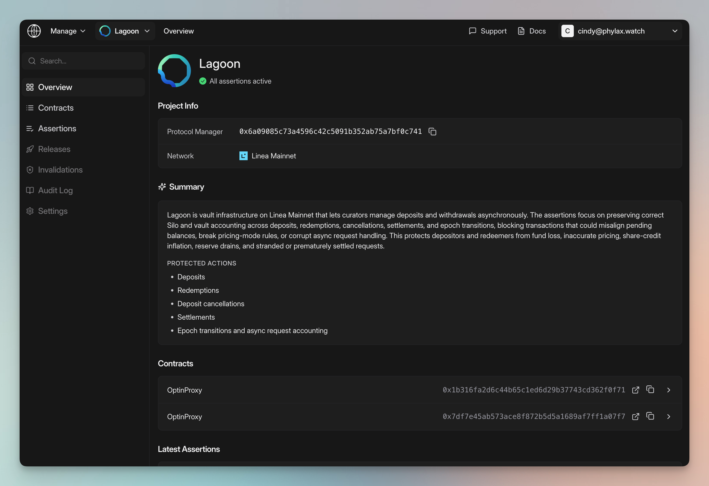

The Phylax Explorer shows a small selection of featured projects. Their public pages show protected contracts, policy summaries, and operational authority where available.

<Warning>
**Availability update:** The security posture service described on this page is currently not available by default to all projects.
</Warning>

## Review the Protection

Open a project to see its protected contracts and the actions its circuit breakers check. Release-generated summaries connect each policy to its assertion code, triggers, and intended behavior.

<Frame caption="A featured project's protection summary and linked contracts">
  
</Frame>

Review guard coverage and recovery settings alongside the active policies.

## Review Authority and Change Paths

The operational-risk view shows who can change the reviewed contracts, the approvals required, and any enforced delays. Expand a route to inspect the accounts and contracts behind it, including alternative paths that could bypass those controls.

<Frame caption="Inspect operational authority and contract change paths">
  <video controls playsInline preload="metadata" alt="Security posture and operational authority walkthrough" aria-label="Security posture and operational authority walkthrough" style={{ width: "100%" }}>
    <source src="/images/phylax-operational-risk.mp4" type="video/mp4" />
  </video>
</Frame>
