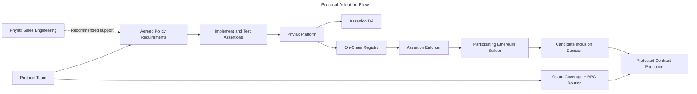

Plan guard coverage, transaction routing, and recovery with your [FDE](./work-with-phylax). Use this checklist before [deployment](./deploy-assertions-dapp).

## Prerequisites

Agree on the policy scope and review responsibilities. Identify the protected contracts, policy signers, and transaction submitters. Confirm the network, supported assertion specification, and test environment.

## Adoption Workflow

Your team approves the policies and exceptions. Engineers implement and test assertions, then prepare a release with `pcl apply`. Your signers authorize activation.

See [Work with Phylax](./work-with-phylax#the-integration-process) for the delivery process.

## End-to-End Flow

## What You Control

Your team controls policy assignments, deployment environments, and notification settings. Deployment authority remains separate from project membership and protocol administration.

## Map Coverage and Required Contract Changes

Identify the protected operations, relevant state, dependencies, and coverage gaps. Every protected execution path must reach a suitable guard.

Include alternative entry points and wallet modules. A Safe transaction guard alone does not cover module execution. Resolve unguarded paths before claiming coverage.

Assign responsibility for contract changes and review the deployed version. Include guard replacement and bypass permissions in that review.

## Configure Transaction Submission

Configure the Credible RPC on each top-level submitter of protected transactions. This includes automated submitters and multisig executors. Off-chain signers and internally called contracts do not select the route.

Ordinary reads and unprotected traffic can retain their existing providers. Test actual submission separately from RPC simulation. Simulation success does not establish that production assertions pass.

For L2 queues and forced inclusion, see [L2 Integration Planning](./l2-integrations/network-integration#transaction-source-coverage).

## Authorization Requirements

Confirm the Protocol Manager for each contract through [Managing Policy Deployments](./managing-policy-deployments). Record the signing policy, recovery path, and deployed delays for each privileged role.

## Deployment Modes

- **Alerting** records violations in a mirrored environment without blocking live transactions. It does not test every production guard or route.
- **Production** enforces active policies through participating builders. Protected operations require configured guards and routing.

## Test Availability and Recovery

Follow the [testing strategy](./testing-strategy) and [guard tests](./testing-credible-block-guard). Include blocked recovery transactions and lost keys.

A block-gap fallback may not resolve false positives if credible blocks continue. Define how submitters investigate exclusions and retry. Do not assume automatic resubmission.

## What Users Can Verify

Users can inspect active policies and onchain state. Where public [Explorer views](./dapp-explorer) are available, they show selected protection details. Private transaction traces require project access.

## What Successful Rollout Looks Like

Activate production after policy, guard, routing, and recovery tests pass. Assign responsibility for alerts, policy changes, and periods of reduced enforcement.

## Next Steps

<CardGroup cols={2}>
  <Card title="Deploy Assertions" icon="rocket" href="/credible/deploy-assertions-dapp">
    Step-by-step deployment guide
  </Card>
  <Card title="Assertions Overview" icon="code" href="/credible/assertions-overview">
    Learn how assertions work and how to write them
  </Card>
  <Card title="Platform Overview" icon="browser" href="/credible/dapp-overview">
    Understand how the platform is used by teams and users
  </Card>
</CardGroup>
