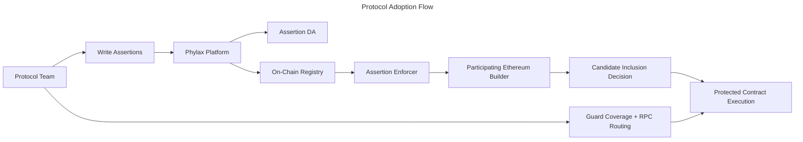

This guide shows you how to plan an Ethereum integration from protected contract paths through assertion activation and operational recovery.

<Note>
If you are ready to execute deployment, use [Deploy Assertions with the Platform](./deploy-assertions-dapp). If you need background on how the system works, start with the [Architecture Overview](./architecture-overview).
</Note>

## Prerequisites

Confirm the target network, supported assertion specification, and available staging or test environment. Identify protocol owners, assertion managers, contract addresses, and the team responsible for transaction submission.

Use this plan before deployment to agree on implementation ownership, review scope, and recovery responsibilities.

<Note>
Assertion management requires authorization for the target contracts. Confirm the supported verifier or approved [manual registration process](./manual-verification) for your deployment. Registration does not install an enforcement gate or configure transaction routing.
</Note>

## Adoption Workflow

Teams follow the same underlying steps. The CLI is used to author and deploy assertions, while the platform
is used to manage deployments and monitoring.

- **CLI authoring**: write assertions locally and create a release with `pcl apply`
- **Platform management**: link contracts, stage or deploy, and monitor invalidations

## End-to-End Flow

## What You Control

- Which assertions protect which contracts
- Staging vs production deployments
- Invalidation notification routing and monitoring

## Map Coverage and Required Contract Changes

Before writing assertions, map the surfaces you intend to protect:

- Protected contracts and external entry points
- Privileged roles and admin operations
- Critical state variables and accounting relationships
- Oracle, bridge, vault, and downstream market dependencies
- High-risk user flows, such as borrows, withdrawals, upgrades, and parameter changes
- Known gaps that the first assertion release will not cover

For Ethereum, identify the guard or gate for every protected path. Include alternative entry points, internal calls, privileged actions, and wallet modules. A Safe transaction guard does not cover module execution by itself. If a path has no suitable gate, record the gap and resolve it before claiming coverage.

Agree on who implements contract changes, who reviews them, and which deployed version the review covers. Review any guard replacement or bypass authority along with the assertions.

## Configure Transaction Submission

Inventory every top-level submitter for guarded operations: user wallets, multisig executors, keepers, bots, relayers, and bridge or settlement services. Configure the required Credible RPC route for each. Off-chain multisig signers and internally called contracts do not choose the final submission route.

Keep ordinary reads and unprotected traffic on their existing providers where appropriate. Test simulations and actual submission separately; a successful RPC simulation does not establish that production assertions pass.

For Ethereum bridge and relayer operations, check the submitted transaction and its actual contract path. L2 delayed queues and forced-inclusion rules are covered separately in [L2 Integration Planning](./l2-integrations/network-integration#transaction-source-coverage).

## Authorization Requirements

Confirm the Protocol Manager authorized by the State Oracle for each contract. Use the supported automatic verifier or [manual verification](./manual-verification) process. Distinguish this authority from platform membership, transaction submission, protocol upgrades, and guard administration.

Document the signing policy and recovery path for each privileged role. Verify the deployed lifecycle delays rather than assuming immediate activation or rollback.

## Deployment Modes

- **Staging**: observe assertion behavior against a mirrored chain environment without dropping live transactions; this does not test every production guard and routing path
- **Production**: participating Ethereum builders enforce active assertions, with guard coverage and routing configured for the protected operations

Learn more about ownership checks in [Ownership Verification](/credible/ownership-verification).

## Test Availability and Recovery

Test both allowed and rejected operations, including batch failures and exceptional administrative actions. For guarded integrations, test credible and noncredible blocks, the exact fail-open boundary, Registry errors, and any authorized bypass.

Rehearse lost keys, restrictive assertions, and blocked recovery transactions. A block-gap fallback may not help if builders continue producing credible blocks. Confirm how submitters reconcile exclusions and retry safely; do not assume automatic resubmission.

See [Testing Strategy](./testing-strategy), [Guard Testing](./testing-credible-block-guard), and the [FAQ](./faq).

## What Users Can Verify

- Which assertions are active for a protocol
- On-chain registry entries and views in The Phylax Explorer
- Publicly exposed posture and invalidation information; private traces and payloads remain restricted
- Guard coverage, recovery conditions, and administrative authority disclosed for the integration

## What Successful Rollout Looks Like

- Reviewed assertions cover the agreed invariants and operational cases
- Every protected path reaches the required enforcement boundary or guard
- Actual submitters can route transactions successfully, and rejected operations are reconciled
- Staging, integration, and recovery checks pass before production activation
- Teams monitor invalidations, lifecycle changes, and periods of reduced enforcement

## Next Steps

<CardGroup cols={2}>
  <Card title="Deploy Assertions" icon="rocket" href="/credible/deploy-assertions-dapp">
    Step-by-step deployment guide
  </Card>
  <Card title="Assertions Overview" icon="code" href="/credible/assertions-overview">
    Learn how assertions work and how to write them
  </Card>
  <Card title="Platform Overview" icon="browser" href="/credible/dapp-overview">
    Understand how the platform is used by teams and users
  </Card>
</CardGroup>
