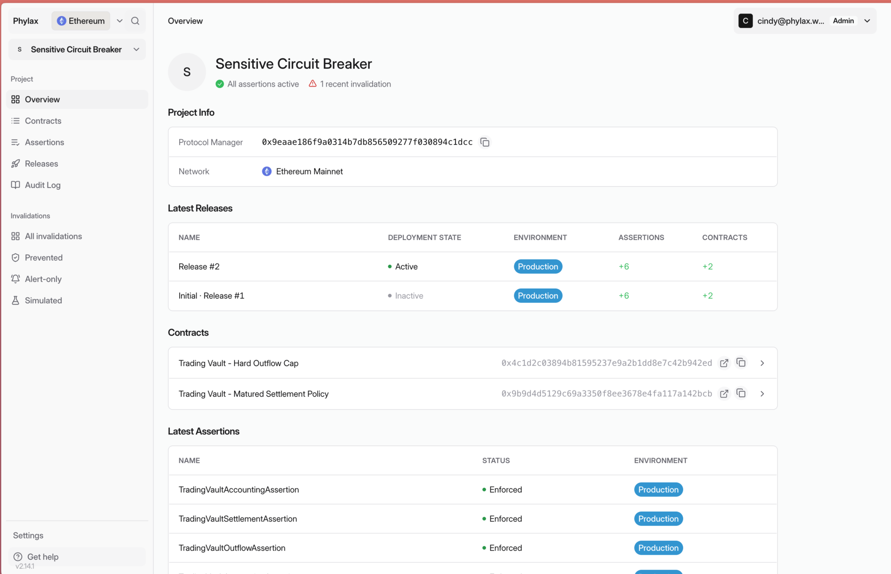

Use the [Phylax platform](https://ethereum.phylax.systems) to review circuit breakers, authorize changes, and investigate policy violations.

<Frame caption="Your project overview shows releases, contracts, and assertion status">
  
</Frame>

<CardGroup cols={2}>
  <Card title="Setting Up Alerting" icon="bell" href="./setting-up-alerting">
    Send circuit-breaker alerts to your team in Slack.
  </Card>
  <Card title="Managing Your Circuit Breakers" icon="sliders" href="./managing-your-circuit-breakers">
    Review releases, authorize changes, and inspect rejected transactions.
  </Card>
</CardGroup>

For featured projects with public evidence, see [Security Posture in the Explorer](./dapp-explorer). For the complete integration workflow, follow [Use the Phylax Platform](./use-the-platform).
