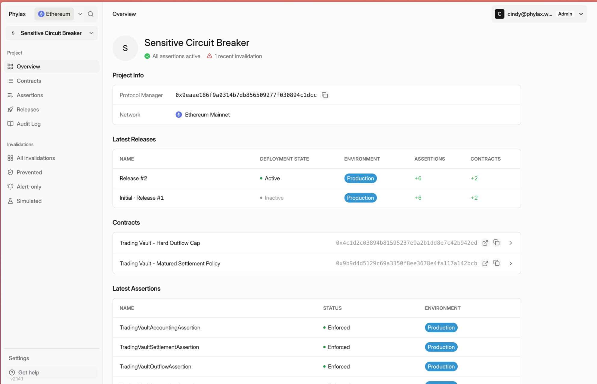

Use the [Phylax platform](https://ethereum.phylax.systems) to review circuit breakers, authorize changes, and investigate policy violations.

<Frame caption="Your project overview shows releases, contracts, and assertion status">
  
</Frame>

<CardGroup cols={2}>
  <Card title="Assign a protocol manager" icon="wallet" href="./assign-protocol-manager">
    Choose the signing account that authorizes your circuit breaker releases.
  </Card>
  <Card title="Review and deploy changes" icon="sliders" href="./deploy-assertions-dapp">
    Review releases and authorize policy changes.
  </Card>
  <Card title="Review Backtesting Results" icon="clock-rotate-left" href="./backtesting">
    Check historical coverage and investigate unexpected rejections before signing.
  </Card>
  <Card title="Inspect or Replace a Release" icon="sliders" href="./managing-your-circuit-breakers">
    Inspect active policies, replace their complete policy set, or schedule removal.
  </Card>
  <Card title="Investigate a Rejected Transaction" icon="magnifying-glass" href="./investigate-rejected-transaction">
    Read rejection reasons and compare execution traces.
  </Card>
  <Card title="Set Up Slack Notifications" icon="bell" href="./setting-up-alerting">
    Send notifications to Slack and test delivery. This is separate from deploying a release to Alerting.
  </Card>
</CardGroup>

For featured projects with public evidence, see [Security Posture in the Explorer](./dapp-explorer). For the complete integration workflow, follow [Use the Phylax Platform](./use-the-platform).
