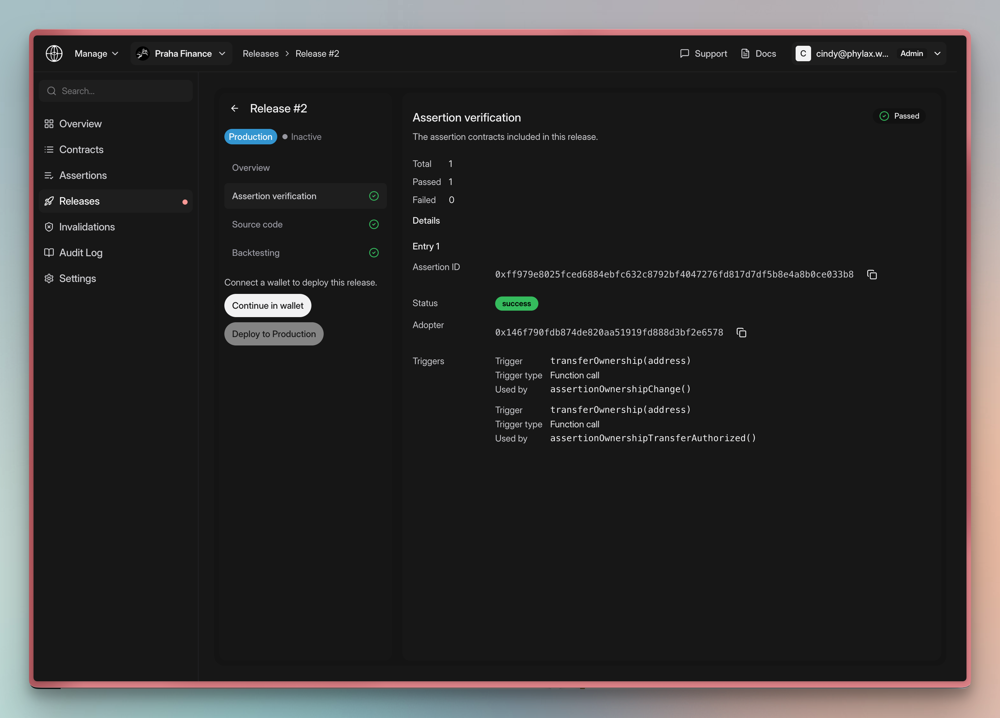

Prepare a release, review its checks, and authorize deployment in the [Phylax platform](https://ethereum.phylax.systems). A release contains the complete intended policy set. To change or remove individual assertions, deploy a replacement release.

## Before You Start

You need:

- Approved policies and assigned reviewers
- [pcl installed](./credible-install) and an assertion [written](./writing-your-own-policies) and [tested](./testing-assertions)
- Target contracts and an [assigned Protocol Manager](./assign-protocol-manager) authorized for them on the approved Ethereum deployment
- For production, reviewed guards, transaction routing, and recovery under the [Ethereum integration plan](./dapp-integration)

## Step 1: Authenticate

```bash
pcl auth -u https://ethereum.phylax.systems login
```

Open the login link from your terminal. Sign in and enter the CLI login code. Confirm that the session uses the Ethereum platform.

## Step 2: Create a Project

If your project already exists, open it and continue to the next step. Otherwise:

1. Select **Create a Project** under **Projects**.
2. Enter the protocol name, description, and target chain.
3. Select **Continue to contract selection**.
4. Add the contracts your wallet is authorized to manage.
5. Review the details and select **Create Project**.

The platform checks contract administration permissions. See [Managing Policy Deployments](./managing-policy-deployments).

## Step 3: Apply Your Assertions

Configure your `credible.toml` and create a release with `pcl apply`:

```bash
pcl apply
```

Review the preview and confirm to create a pending release. See [Apply Assertions](./apply-assertions) for configuration. Creating a release does not activate it.

## Step 4: Review Release Checks

Open the release under **Releases → Needs your review**. Compare its target contracts, environment, and policy additions and removals with the approved changes. **All passed** does not mean the release is deployed. Review all three checks below; see the [screenshot walkthrough](./managing-your-circuit-breakers#review-a-release).

### Assertion verification

Confirm that every assertion passed. Match its **Assertion ID**, **Adopter** (protected contract), and registered triggers to the approved policy. Check each trigger's type, selector or identifier, and **Used by** assertion function.

<Frame caption="Assertion verification maps each assertion to its adopter and registered triggers">
  
</Frame>

Verification checks the submitted configuration; it does not establish that the policy protects the intended behavior.

### Source code

Confirm that every **Assertion ID** in the release has a **Passed** source result. Source verification does not audit the assertion or establish that its logic is correct.

### Backtesting

The **Backtesting** check evaluates the release against historical transactions. Review the reported block range, watched assertion IDs, and **Transactions With Assertions**. A **Passed** result with zero transactions exercising assertions does not demonstrate policy behavior.

Open each **Issue found** result to inspect the matched transaction, assertion, adopter, and replay data. Determine whether the rejection is intended or a false positive. Use [How to Review Backtesting Results](./backtesting) for the investigation workflow.

Resolve failed verification checks and unexpected backtesting findings before signing. Passing checks do not establish complete coverage. Complete [local and integration tests](./testing-strategy) before production.

<span id="step-4-deploy-the-assertion" />

## Step 5: Authorize Deployment

1. Confirm the release's environment. **Alerting** records violations without blocking live transactions. **Production** excludes violating candidates at participating builders.
2. Connect your authorized policy-management wallet.
3. Select **Deploy to Alerting** or **Deploy to Production**.
4. Authorize the transaction through your signing process.

The [State Oracle](./credible-layer-contracts#state-oracle) applies the configured delay before activation. After the transaction confirms, check **Assertions** for **Awaiting activation** and the remaining block count. Confirm enforcement after the delay; a signed deployment alone is insufficient. See the [deployment and activation screenshots](./managing-your-circuit-breakers#authorize-the-change). Platform membership does not grant signing authority.

## Verify Ethereum Enforcement

With your FDE, verify an allowed operation and an assertion violation in the approved test environment. Check the assertion result and contract state. A timeout alone does not prove rejection.

Test a protected call in a noncredible block while the guard is active. Include the actual submitters, alternative entry points, and recovery conditions in the [test plan](./testing-strategy).

<span id="step-5-monitor-your-assertions" />

## Step 6: Monitor Your Policies

Use [Review and deploy changes](./managing-your-circuit-breakers) to check active policies and [Investigate a Rejected Transaction](./investigate-rejected-transaction) to inspect violations. To change the policy set or stop a release, follow [Replace or Remove a Release](./managing-your-circuit-breakers#replace-or-remove-a-release).

## Troubleshooting

| Error | Solution |
| --- | --- |
| Contract registration is not authorized | Confirm the supported admin verifier and manager authorization for the target Ethereum deployment; see [Managing Policy Deployments](./managing-policy-deployments) |
| "Assertion already exists" | Check the existing assertion IDs and release diff before preparing a replacement release |
| "Authentication expired" | Run `pcl auth -u https://ethereum.phylax.systems login` to refresh |
