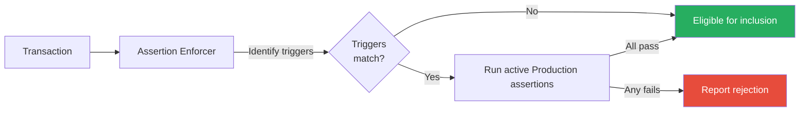
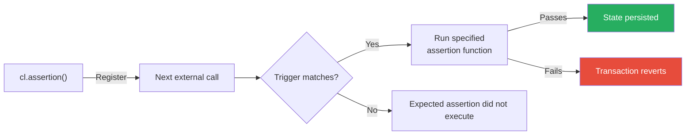

On Ethereum, the Assertion Enforcer reports failures to the participating builder, which excludes failing candidates before inclusion. The enforcer does not make the inclusion decision. A separate on-chain guard can revert a protected operation in a noncredible block while its gate is closed.

In local `CredibleTest` tests, failed assertions cause **reverts**. This lets you use `vm.expectRevert()` to verify your assertion catches violations and returns the expected error message.

## Quick Comparison

| Aspect | Local `CredibleTest` | Production |
|--------|---------|------------|
| **When assertion fails** | Transaction reverts | Rejection reported to the network integration |
| **Which assertion runs** | Specified by `fnSelector` | Matching active Production assertions |
| **Scope** | Next external call only | Matching active assertions for candidates evaluated by participating builders |
| **Guard behavior** | Requires separate integration tests | On-chain gate checks block credibility; fail-open and bypass conditions depend on the guard |

## Production: Ethereum Builders Apply the Result

In production, the [Assertion Enforcer](./assertion-enforcer) validates transactions during block building:

The candidate must pass its matching active Production assertions. The builder excludes failing candidates. Passing validation does not guarantee inclusion. Guards restrict protected operations in other builders' blocks.

## Testing: Transactions Revert

In local tests, `cl.assertion()` registers an assertion to run on the next external call:

Key behaviors:
- You specify the assertion function via `fnSelector`, but triggers still determine if it runs
- Only the specified assertion runs, not all assertions for the contract
- Only the next external call is validated, then the registration is consumed
- Reverts simulate drops - use `vm.expectRevert()` to test failure cases

## The `cl.assertion()` Mental Model

`cl.assertion()` selects one assertion function for the next monitored external call. An intervening external call consumes the registration. The selected function still needs a matching trigger; selecting it is not a substitute for registering the trigger.

The test wrapper models assertion rejection as a revert so a test can check both the reason and rollback. It does not reproduce Ethereum builder selection, credible-block marking, or an onchain guard decision. See [How to Test Assertions](./testing-assertions#register-an-assertion-for-the-next-external-call) for the setup pattern.

### State Persistence

A passing operation retains its state changes for later calls in the test. A rejected operation rolls back. Each subsequent monitored call needs its own registration. To test several operations as one transaction, use a [batch helper](./testing-assertions#batch-operation-testing-pattern).

## Common Pitfalls

### "Expected 1 assertion to be executed, but 0 were executed"

This local-harness message means the expected function did not execute. It does not demonstrate that the policy accepted or rejected the operation. The [troubleshooting guide](./troubleshooting#assertion-not-executing) covers consumed registrations, trigger mismatches, and protocol reverts.

### Trigger Mismatch

A test can select the right assertion function but call an operation outside that function's registered triggers. A zero-execution result identifies a coverage or test-setup gap. Changing the assertion condition cannot fix a trigger that never selects it; compare the target selector and registration in [Triggers](./triggers).

## Alerting and Backtesting

Alerting evaluates mirrored live activity without excluding live transactions. Release backtesting evaluates a reported historical range under the proposed release. Neither uses the local test's next-call registration, and neither proves that Production guards or routing work.

A clean result needs evidence that relevant transactions exercised the assertions. Use [Backtesting](./backtesting) to review historical coverage and the [integration test plan](./testing-strategy) for the remaining enforcement checks.

## Related Documentation

<CardGroup cols={2}>
  <Card title="Testing Assertions" icon="flask" href="./testing-assertions">
    Testing patterns
  </Card>
  <Card title="Triggers" icon="bolt" href="./triggers">
    Production trigger behavior
  </Card>
  <Card title="Backtesting" icon="clock-rotate-left" href="./backtesting">
    Review historical findings attached to a platform release
  </Card>
  <Card title="Troubleshooting" icon="wrench" href="./troubleshooting">
    Common errors
  </Card>
</CardGroup>
