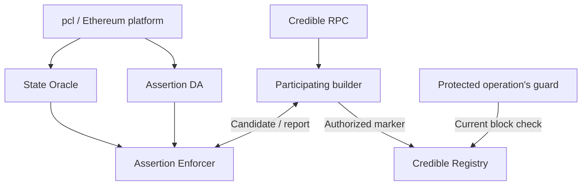

Ethereum enforcement has two linked paths: preparing assertion policy, and validating and gating protected transactions. The interfaces below keep assertion management, block marking, and contract execution distinct.

## Interface Map

## Responsibilities

| Interface | Responsibility | Coordination |
| --- | --- | --- |
| CLI ↔ Platform API | Authentication, project selection, and releases | Platform and CLI maintainers |
| Authorized manager ↔ State Oracle | Assertion assignments and lifecycle actions | Protocol team and contracts maintainers |
| Enforcer ↔ State Oracle | Index active rules and their effective times | Enforcer and contracts maintainers |
| Enforcer ↔ Assertion DA | Prepare and cache assertion artifacts | DA and enforcer maintainers |
| Credible RPC → Builder | Route top-level submissions | RPC and builder operators |
| Builder ↔ Enforcer | Supply candidate context and apply validation reports | Builder and enforcer operators |
| Builder → Credible Registry | Mark blocks under the authorized builder policy | Builder and Registry administrators |
| Guard → Credible Registry | Check whether the protected operation may execute | Protocol integrators and contracts maintainers |

See [Trust Model](./trust-model) for the guarantees and assumptions at each interface.

## Product and Protocol Boundaries

The State Oracle controls assertion authority and timing. The Credible Registry records builder authorization and block markers. Guards check the Registry while preserving ordinary protocol checks.

The platform coordinates release review and operation. Assertion DA supplies artifacts.

## Changes Requiring Review

Review interface changes against the deployed contracts and software. Test successful execution and dependency failures. Use [Integration Planning](./dapp-integration) for protocol changes.

Sequencer interfaces are covered under [L2 and Sequencer Integrations](./l2-integrations/overview).
