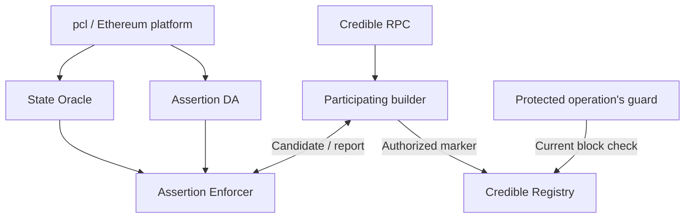

Ethereum enforcement has two linked paths: preparing assertion policy, and validating and gating protected transactions. The interfaces below keep assertion management, block marking, and contract execution distinct.

## Interface Map

## Responsibilities

| Interface | Responsibility | Coordination |
| --- | --- | --- |
| CLI ↔ Platform API | Authentication, project selection, and releases | Platform and CLI maintainers |
| Authorized manager ↔ State Oracle | Assertion assignments and lifecycle actions | Protocol team and contracts maintainers |
| Enforcer ↔ State Oracle | Index active rules and their effective times | Enforcer and contracts maintainers |
| Enforcer ↔ Assertion DA | Prepare and cache assertion artifacts | DA and enforcer maintainers |
| Credible RPC → Builder | Route top-level submissions | RPC and builder operators |
| Builder ↔ Enforcer | Supply candidate context and apply validation reports | Builder and enforcer operators |
| Builder → Credible Registry | Mark blocks under the authorized builder policy | Builder and Registry administrators |
| Guard → Credible Registry | Check whether the protected operation may execute | Protocol integrators and contracts maintainers |

A validation report is not a transaction inclusion guarantee. A block marker is not a proof of assertion execution. A platform project is not an on-chain enforcement gate.

## Product and Protocol Boundaries

The State Oracle coordinates assertion authority and timing. The Credible Registry coordinates builder authorization and block credibility. Protocol guards consume the latter and preserve the protocol's ordinary checks.

The platform, release backtesting, staging, and Assertion DA support authoring, review, operations, and artifact delivery. Public Explorer views expose selected posture and evidence; private traces and project records remain access-controlled. A platform view does not replace checking deployed contract configuration.

## Changes Requiring Review

Coordinate changes to contract ABIs, event indexing, assertion specifications, guard implementations, builder software, and routing. Test both successful execution and degraded dependencies against the exact deployment. Review [Trust Model](./trust-model) and [Integration Planning](./dapp-integration).

Sequencer hooks, delayed queues, and Rollup-Boost interfaces are covered under [L2 and Sequencer Integrations](./l2-integrations/overview).
