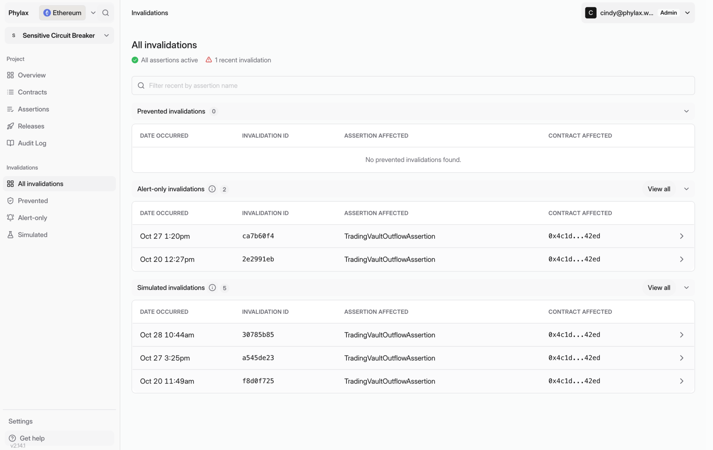
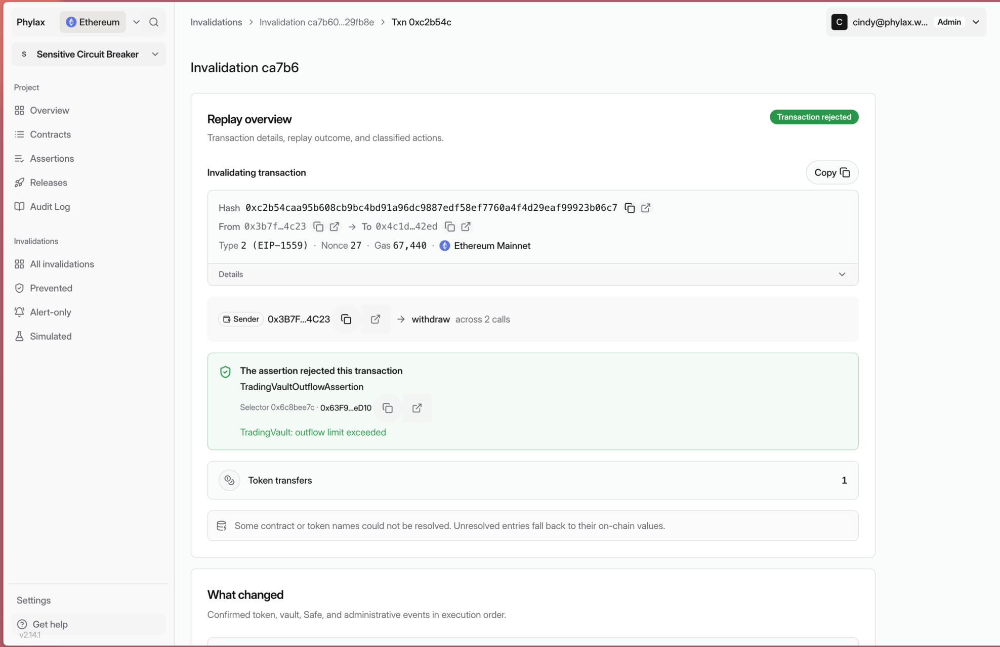
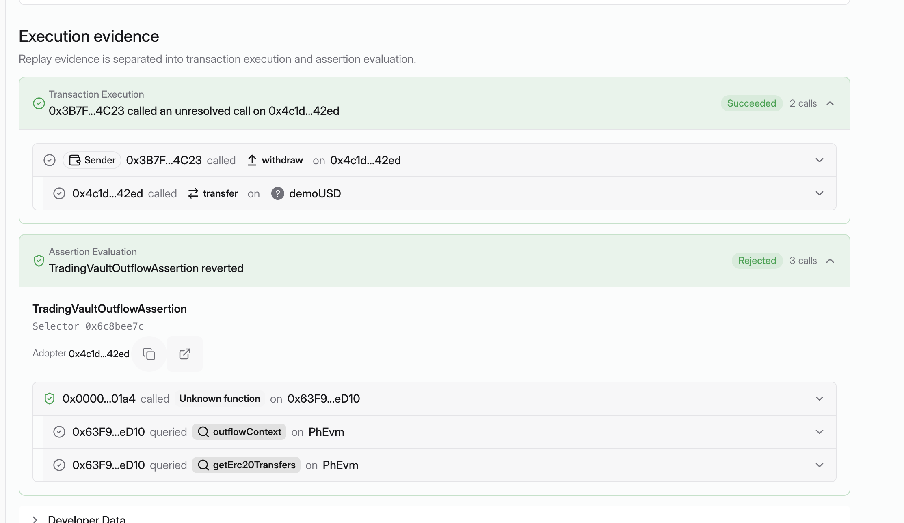
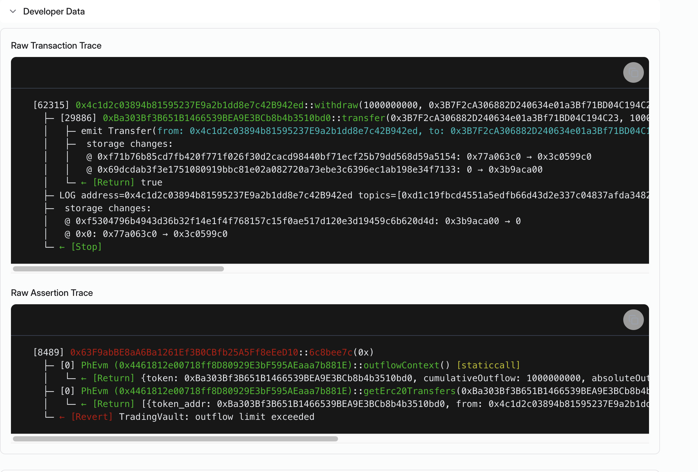

Use the [Phylax platform](https://ethereum.phylax.systems) to identify which assertion failed and why. You need access to the project's invalidation details. Open your project or follow an alert's investigation link; first establish whether the result concerns Production enforcement, Alerting, or simulation.

## 1. Find the Event

Open **All invalidations**, filter by assertion name, and select an event. Check its category:

| Category | Meaning |
| --- | --- |
| Prevented | Reported exclusion at the integrated enforcement boundary. Confirm the transaction status and protected state before concluding what was prevented. |
| Alert-only | Assertion failures observed without blocking live transactions. |
| Simulated | Simulation results. |

<Frame caption="Invalidations are grouped by outcome; this example has alert-only and simulated events">
  
</Frame>

## 2. Read the Rejection Reason

Open the transaction replay. In **Replay overview**, check the transaction, affected contract, assertion, and rejection reason. **What changed** shows transfers and other events from the replay.

<Frame caption="The replay identifies the assertion and its outflow-limit rejection reason">
  
</Frame>

This event is **Alert-only**. The **Transaction rejected** badge describes the replay result, not a live transaction being blocked. An onchain guard revert is a separate event from an assertion rejection.

## 3. Compare Execution Evidence

Expand **Transaction Execution** and **Assertion Evaluation** under **Execution evidence**. Follow the protocol calls, then inspect the assertion that rejected their outcome.

In this example, the withdrawal and token transfer succeed in the replay. `TradingVaultOutflowAssertion` then reads `outflowContext` and `getErc20Transfers` and rejects the result.

<Frame caption="The protocol calls succeed in the replay; the assertion evaluation rejects their outcome">
  
</Frame>

## 4. Inspect the Raw Traces

Expand **Developer Data**. Compare **Raw Transaction Trace** with **Raw Assertion Trace** to inspect call arguments, return values, storage changes, and the assertion's revert reason.

The assertion trace below ends with `TradingVault: outflow limit exceeded`. Use the copy button to share the relevant trace with your FDE.

<Frame caption="The raw assertion trace ends with the outflow-limit rejection">
  
</Frame>

## 5. Review the Outcome

Compare the rejection with the approved policy. Distinguish a policy condition from an execution failure such as out-of-gas, and confirm whether the event was prevented, alert-only, or simulated. If the check rejects intended behavior, review the event with your FDE and add a regression test before [replacing the release](./managing-your-circuit-breakers#replace-or-remove-a-release). Include the policies you intend to retain; assertions cannot be removed individually from an active release.

Record the environment, transaction hash, assertion ID and failing function, adopter, failure reason, and whether the result matches the policy. Distinguish a policy violation, false positive, and execution error. Assign the next action and reviewer; an unexplained failure is still open.

To receive invalidation notifications in Slack, follow [Set Up Slack Notifications](./setting-up-alerting).
