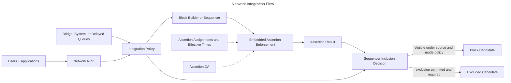

Plan an embedded assertion-library integration in the sequencer's block-building pipeline. The sequencer fills the builder role: it executes candidates, enforces assertions on their effects, and decides what to include. Each L2 needs its own coverage and failure policy.

This is an integration planning guide, not a declaration of support for every L2 client. Confirm the client revision and supported assertion specification before implementation.

Ethereum block builders should use [For Ethereum Builders](../ethereum-builder-integration).

## Who This Is For

L2 sequencer, infrastructure, and security teams.

## High-Level Flow

## Integration Surfaces

Networks provide the following integration surfaces:

- **Block-building hook**: the block builder or sequencer invokes the assertion library within its execution pipeline before including a transaction
- **Transaction-source policy**: the integration defines how user-submitted, system-originated, bridge-originated, delayed, or forced-inclusion-style transaction paths are covered by enforcement
- **Result routing**: enforcement results are routed back into the block-building or sequencing policy that decides whether a candidate transaction can be included
- **Assertion-state access**: the enforcer consumes assertion assignments and their effective times from the deployment's on-chain state, such as the State Oracle; this is separate from Ethereum's Credible Registry block markers
- **Assertion data access**: the enforcer fetches assertion bytecode from Assertion DA
- **Operational monitoring**: invalidations, assertion status, alerting, and audit-log events are surfaced via the Phylax platform

## Integration Policy Decisions

### Transaction Source Coverage

For each transaction source, record the enforcement boundary, inclusion rules, timeout behavior, and invalidation metadata. Include bridge, system, delayed, and forced-inclusion transactions.

If a response window exists, define the protocol actions it permits before inclusion.

### Bounded Response Windows

If the design delays an inclusion decision, define the maximum delay and expiry behavior. Specify permitted protocol responses and record every delayed, retried, or released transaction.

### Ingress traffic management

Cache repeated invalid submissions or use short-lived fingerprints and sender budgets. Broader matches need conservative thresholds and expiry times to avoid suppressing legitimate traffic.

## Operational Expectations

- The embedded enforcer runs within the block-building pipeline; assertion acceptance is an inclusion policy, not a new consensus rule
- Enforcement is deterministic for the same assertion, state, and execution context
- Protocol teams choose Alerting or Production mode; the integration applies the effective assertion state and its transaction-source policy. An Alerting failure does not exclude a live transaction
- Network operators define continuity behavior for maintenance windows, degraded dependencies, and enforcement timeouts
- Production integrations keep assertion work bounded through admission review, trigger scoping, runtime limits, and operational monitoring

## Review the Integration Plan

Record the covered transaction sources, enforcement boundaries, timeout decisions, supported assertion specification, and operational owners. Review them with Phylax before implementation. Confirm the network-specific policy-management and investigation workflow; the main platform guides describe Ethereum.

## Next Steps

<CardGroup cols={2}>
  <Card title="Sequencer Enforcement Pipelines" icon="diagram-project" href="./validation-pipeline">
    Examine execution ordering, rollback, timeouts, and backpressure for the L2 design
  </Card>
  <Card title="Assertion Enforcer" icon="shield" href="../assertion-enforcer">
    Enforcement flow, integration boundaries, and enforcement role
  </Card>
  <Card title="Sequencer Enforcement Boundary" icon="shield-check" href="./overview#the-sequencer-enforcement-boundary">
    Review transaction-source coverage and the sequencer's role in enforcement
  </Card>
</CardGroup>
