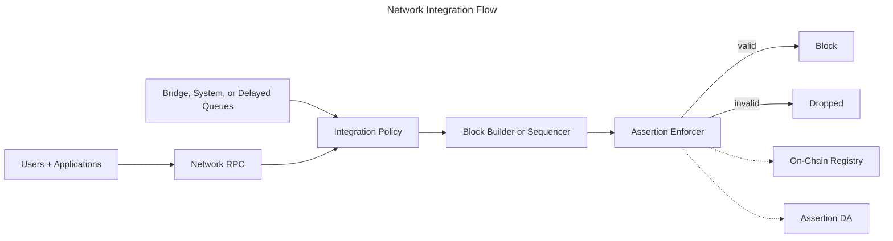

Plan where the sequencer validates transactions and how it handles failures. Each L2 needs its own coverage and failure policy.

Ethereum block builders should use [For Ethereum Builders](../ethereum-builder-integration).

## Who This Is For

L2 sequencer, infrastructure, and security teams.

## High-Level Flow

## Integration Surfaces

Networks provide the following integration surfaces:

- **Block-building hook**: the block builder or sequencer queries the Assertion Enforcer before including a transaction
- **Transaction-source policy**: the integration defines how user-submitted, system-originated, bridge-originated, delayed, or forced-inclusion-style transaction paths are validated
- **Result routing**: validation results are routed back into the block-building or sequencing policy that decides whether a candidate transaction can be included
- **Registry access**: the enforcer consumes registry data (indexed from on-chain events) to discover which assertions apply
- **Assertion data access**: the enforcer fetches assertion bytecode from Assertion DA
- **Operational monitoring**: invalidations, assertion status, alerting, and audit-log events are surfaced via the Phylax platform

## Integration Policy Decisions

### Transaction Source Coverage

For each transaction source, record the validation boundary, inclusion rules, timeout behavior, and invalidation metadata. Include bridge, system, delayed, and forced-inclusion transactions.

If a response window exists, define the protocol actions it permits before inclusion.

### Bounded Response Windows

If the design delays an inclusion decision, define the maximum delay and expiry behavior. Specify permitted protocol responses and record every delayed, retried, or released transaction.

### Ingress traffic management

Cache repeated invalid submissions or use short-lived fingerprints and sender budgets. Broader matches need conservative thresholds and expiry times to avoid suppressing legitimate traffic.

## Operational Expectations

- The enforcer runs alongside the block builder and does not change consensus rules
- Validation is deterministic for the same assertion, state, and execution context
- Protocol teams choose whether assertions run in alerting mode or are enforced; networks honor the registry status during validation
- Network operators define continuity behavior for maintenance windows, degraded dependencies, and validation timeouts
- Production integrations keep assertion work bounded through admission review, trigger scoping, runtime limits, and operational monitoring

## Next Steps

<CardGroup cols={2}>
  <Card title="Architecture Overview" icon="diagram-project" href="/credible/architecture-overview">
    Detailed system architecture and transaction flow
  </Card>
  <Card title="Assertion Enforcer" icon="shield" href="/credible/assertion-enforcer">
    Sidecar validation flow and enforcement role
  </Card>
  <Card title="Trust Model" icon="shield-check" href="/credible/trust-model">
    Guarantees, trust boundaries, and operational assumptions
  </Card>
  <Card title="Review and deploy changes" icon="warning" href="../managing-your-circuit-breakers#investigate-a-rejected-transaction">
    Review releases, authorize changes, and investigate rejected transactions.
  </Card>
</CardGroup>
