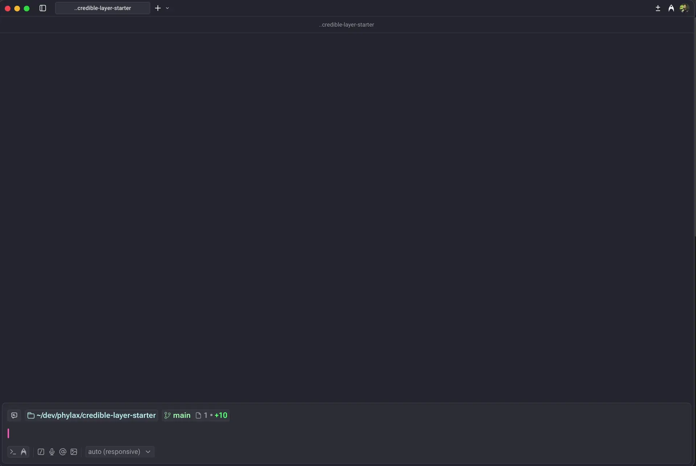
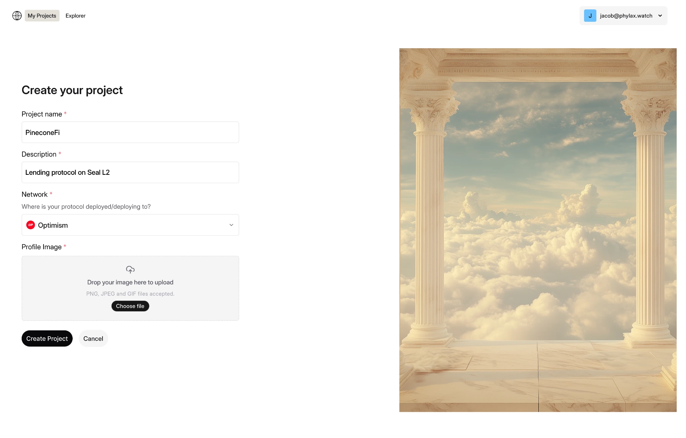
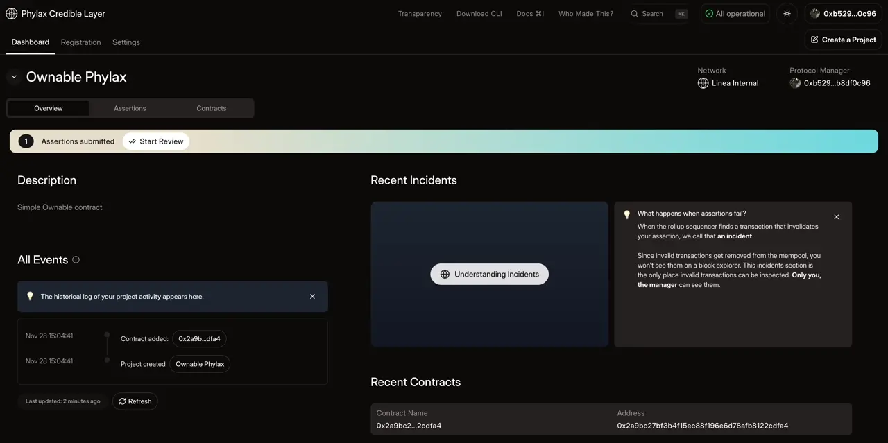

Use these notes when maintaining an existing L2 integration. For Ethereum, use the [Ethereum platform](https://ethereum.phylax.systems) and [Ethereum deployment guide](../deploy-assertions-dapp).

## Platform Selection

The earlier Linea workflow uses [app.phylax.systems](https://app.phylax.systems). Select it explicitly rather than relying on a previously remembered CLI session:

```bash
pcl auth -u https://app.phylax.systems login
pcl auth status
```

The CLI can remember the selected platform. Check the platform, chain, and project before creating a release or signing an activation transaction. CLI fallback defaults are documented in the [CLI reference](../cli-reference#auth).

## Assertion Specifications

Earlier Linea documentation described a Legacy (V1) deployment and warned against deploying Reshiram (V2) assertions there. That restriction is specific to the deployment; it is not a global restriction on the Ethereum platform or the Solidity library.

Confirm the specification accepted by the target enforcer before deployment. A local V2 test passing does not prove that a particular L2 deployment supports V2. Keep Legacy fork-switching examples separate from Reshiram snapshot-read examples.

## Earlier Platform Walkthrough

This video shows the earlier authentication-to-deployment workflow. Its platform selection and UI may differ from the current Ethereum workflow. It does not demonstrate Ethereum guard installation, RPC routing, or end-to-end enforcement.

<iframe width="560" height="315" src="https://www.youtube.com/embed/MrDVLp5UDZ0?si=tdgQEJ3Tkps2LwJA" title="Earlier L2 platform deployment walkthrough" frameBorder="0" allow="accelerometer; autoplay; clipboard-write; encrypted-media; gyroscope; picture-in-picture; web-share" referrerPolicy="strict-origin-when-cross-origin" allowFullScreen></iframe>

## Interpreting the Earlier Demo

The Ownable demo assumed an enforcing sequencer would reject an ownership-change transaction. A transaction timeout alone does not prove assertion enforcement: check invalidation evidence, final transaction status, and contract state.

The same unguarded Ownable contract is not an Ethereum production integration. On Ethereum, another builder can include it without running assertions. Use a reviewed guard or unavoidable gate and test the complete execution path before claiming protection.

## Earlier Interface Examples

These captures accompany the earlier platform workflow and are retained for reference. Use the current Ethereum guides for platform selection and production requirements.

<Frame caption="Earlier authentication flow">
  
</Frame>

<Frame caption="Creating a project in the platform">
  
</Frame>

<Frame caption="Deploying an assertion in the platform">
  
</Frame>
