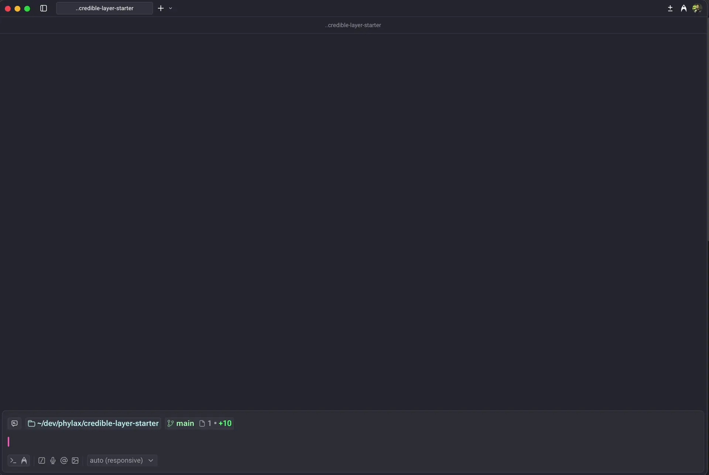
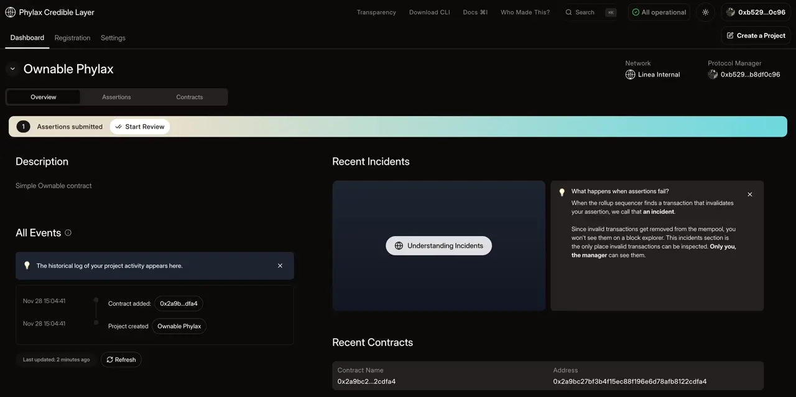

Use these notes when planning or operating an L2 integration; confirm the platform and specification for your target deployment. For Ethereum, use the [Ethereum platform](https://ethereum.phylax.systems) and [Ethereum deployment guide](../deploy-assertions-dapp).

## Platform Selection

L2 platform workflows use [app.phylax.systems](https://app.phylax.systems). Select it explicitly rather than relying on a previously remembered CLI session:

```bash
pcl auth -u https://app.phylax.systems login
pcl auth status
```

The CLI can remember the selected platform. Check the platform, chain, and project before creating a release or signing an activation transaction. CLI fallback defaults are documented in the [CLI reference](../cli-reference#auth).

## L2 Runtime Compatibility

Confirm the assertion specification accepted by the target L2 enforcer before deployment. A Legacy-only runtime cannot run Reshiram assertions; a deployment supporting Reshiram can use its explicit snapshot APIs. Specification support depends on that deployment’s runtime revision, not on being an L2. Confirm the supported precompiles and triggers with the integration team.

The [Assertion Specifications reference](../credible-std-overview#assertion-specifications) covers Legacy and Reshiram APIs, constructor registration, migration, and compatibility checks for every integration.

## Interface Examples

These captures illustrate the L2 platform workflow. Interface details may vary by deployment. Use the current Ethereum guides for platform selection and production requirements.

<Frame caption="L2 authentication flow">
  
</Frame>

<Frame caption="Creating a project in the platform">
  
</Frame>

<Frame caption="Deploying an assertion in the platform">
  
</Frame>
