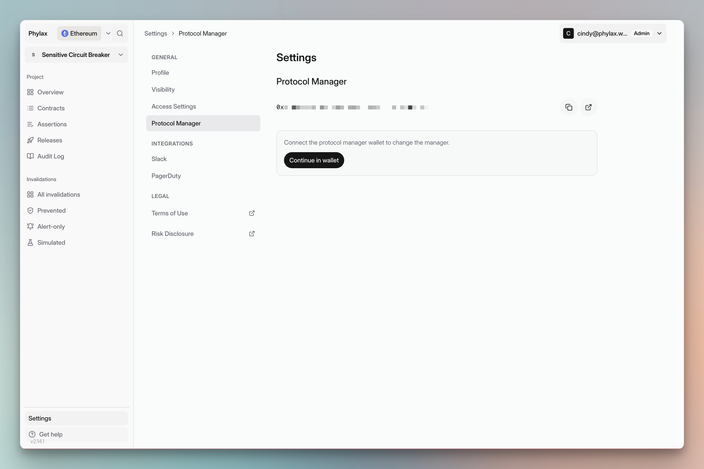

Your team manages policy deployments through the Protocol Manager authorized for each protected Ethereum contract. The State Oracle records this authority and applies the configured activation and removal delays.

## Protocol Manager Authorization

The State Oracle associates a Protocol Manager with registered contracts. This address can perform the assertion lifecycle actions permitted by that deployment. Anyone can author assertion code; only authorized accounts can activate it for the registered contracts.

<Frame caption="View your project's manager under Settings → Protocol Manager">
  
</Frame>

Possible authorization paths include a supported ownership interface such as `owner()` or an explicit initial Protocol Manager interface. Confirm the supported path before changing protocol contracts. A contract does not always need to expose `owner()` to integrate.

Registration establishes assertion-management authority for the agreed contracts. It does not install guards, configure RPC routing, or prove that all intended operations are protected.

## Separate Authorities

Platform project membership, Protocol Manager authority, transaction submission, protocol upgrades, and guard administration are distinct permissions. A wallet used by a backend to submit transactions need not control assertion policy.

A manager can make changes that affect availability and protection, subject to the configured lifecycle. Secure this role with an appropriate signing policy and review how it can be recovered or transferred. Check the deployed authorization and timing rules rather than assuming a fixed delay.

See [Trust Model](./trust-model) for compromise and recovery considerations, and [Integration Planning](./dapp-integration) for rollout requirements.
