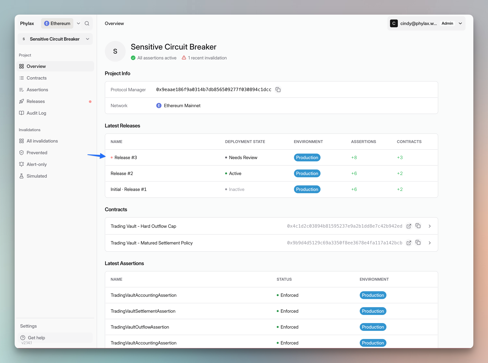
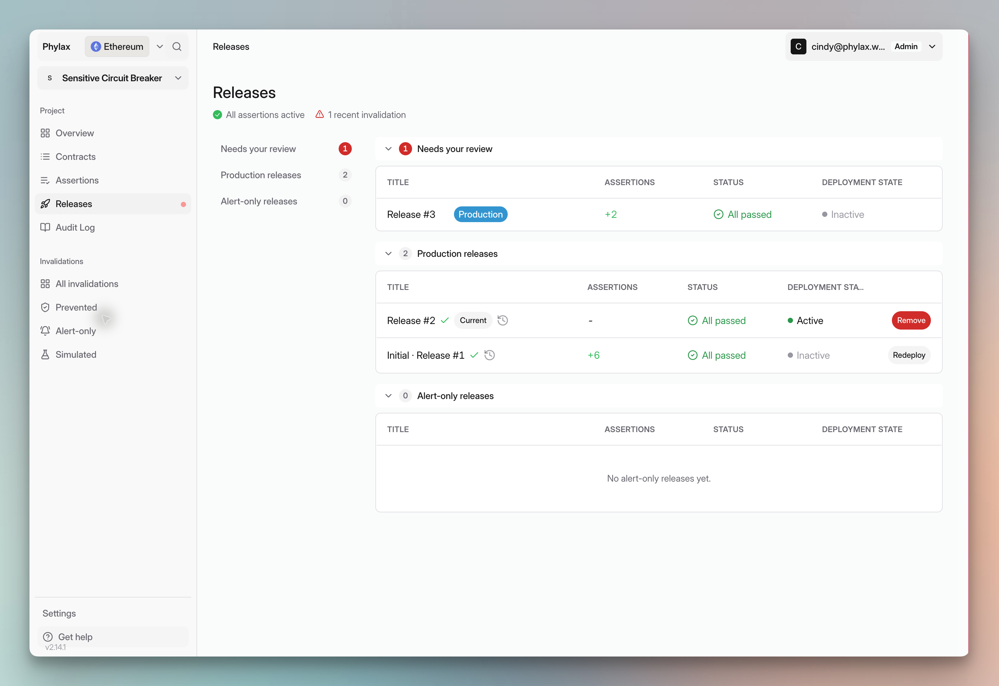
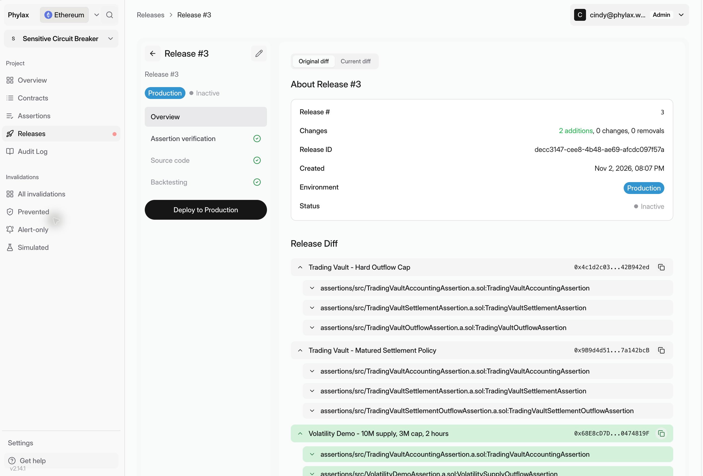
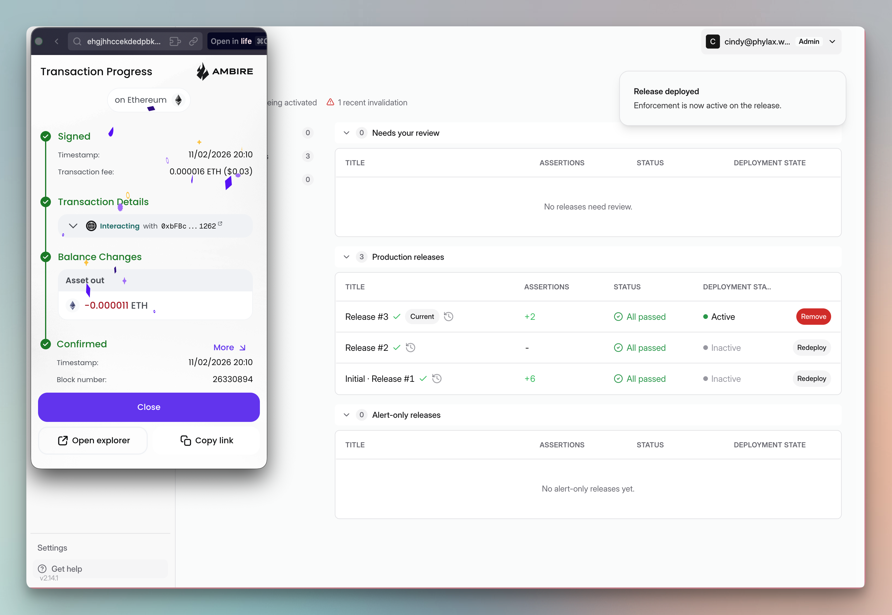
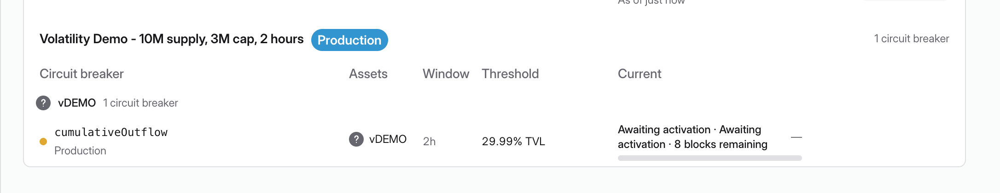
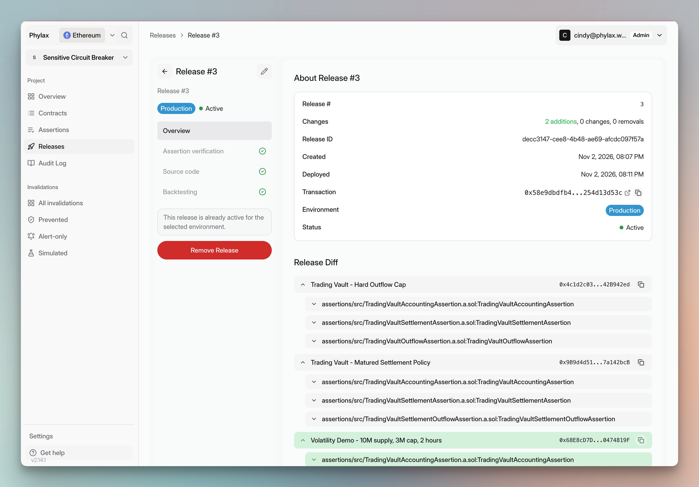
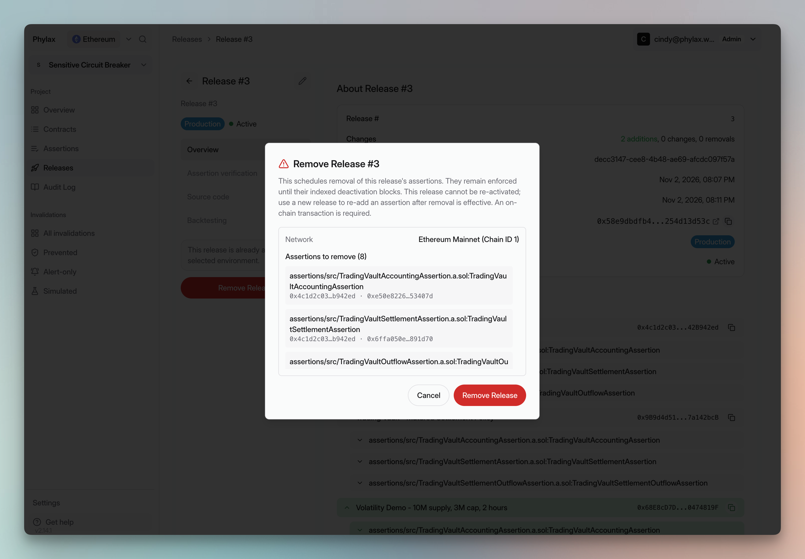

Use the [Phylax platform](https://ethereum.phylax.systems) to review and deploy circuit-breaker releases. Your Protocol Manager signs deployments and removals. Assertions are managed as a complete release; you cannot remove them individually from an active release.

## Check Active Policies

Open **Assertions** to review circuit-breaker activity against its window and threshold. Select an assertion to check its enforcement status and linked contracts.

<Tabs>
  <Tab title="Circuit Breakers">
    <Frame caption="Review each circuit breaker's environment, window, threshold, and current activity">
      
    </Frame>
  </Tab>
  <Tab title="Assertion Details">
    <Frame caption="Inspect an assertion's configuration and use View source code to read its policy">
      
    </Frame>
  </Tab>
</Tabs>

## Review a Release

Open the release marked **Needs Review** under **Latest Releases** on the project overview, or select it under **Releases → Needs your review**. **All passed** reports completed checks; the release still needs your review and deployment authorization.

<Tabs>
  <Tab title="Project Overview">
    <Frame caption="Open the new release marked Needs Review">
      
    </Frame>
  </Tab>
  <Tab title="Releases">
    <Frame caption="A release can pass its checks while remaining inactive and awaiting your review">
      
    </Frame>
  </Tab>
</Tabs>

Check the environment, target contracts, and **Release Diff** against the approved changes. Review **Assertion verification**, **Source code**, and **Backtesting**. Investigate unexpected results with your FDE before signing.

<Frame caption="Review the release contents and completed checks before selecting Deploy to Production">
  
</Frame>

[Review and Deploy Policies](./deploy-assertions-dapp#step-4-review-release-checks) explains each check. [Backtesting Results](./backtesting) shows how to assess the tested history and findings.

## Authorize the Change

1. Connect your [assigned Protocol Manager](./assign-protocol-manager) and confirm the release's environment.
2. Select **Deploy to Production** for the production release shown here.
3. Review and authorize the transaction in your wallet. For a multisig, collect the required approvals and execute it.
4. Wait for transaction confirmation, then check activation in the platform.

<Frame caption="Confirm the deployment transaction in your wallet, then check policy activation">
  
</Frame>

In **Assertions**, newly added policies can show **Awaiting activation** with a remaining block count. Wait for that delay to finish and confirm their enforcement status. A deployment notification or an **Active** release badge alone does not establish that every new assertion is enforcing.

<Tabs>
  <Tab title="Awaiting Activation">
    <Frame caption="This circuit breaker still has eight blocks remaining before activation">
      
    </Frame>
  </Tab>
  <Tab title="Deployed Release">
    <Frame caption="The release overview records the deployment transaction and provides the Remove Release action">
      
    </Frame>
  </Tab>
</Tabs>

Your FDE verifies production protection with you. See [live enforcement checks](./deploy-assertions-dapp#verify-ethereum-enforcement). Project access and [deployment authority](./managing-policy-deployments) are separate.

## Replace or Remove a Release

To change or remove an individual assertion, prepare a **replacement release** with your FDE, developer, or [AI coding agent](./agentic-pcl). Include the complete set of policies you intend to keep. Review its diff and checks, then deploy it through the same signing process. Changes take effect after their configured delays.

To remove the entire release:

1. Open the active release and select **Remove Release**.
2. Check the network and the full **Assertions to remove** list.
3. Confirm **Remove Release** and authorize the onchain transaction with the Protocol Manager.
4. Wait for the indexed deactivation blocks and confirm that removal has taken effect.

<Frame caption="Remove Release schedules removal of all assertions in the release">
  
</Frame>

Assertions remain enforced until their deactivation blocks. A removed release cannot be reactivated. To restore policies after removal takes effect, create and deploy a new release.

For an emergency, follow your agreed [fallback and recovery procedure](./work-with-phylax#fallback-paths-and-recovery).

## Investigate a Rejected Transaction

Open **All invalidations**. **Prevented** lists transactions blocked by enforcement; **Alert-only** lists violations observed without blocking live transactions; **Simulated** lists simulation results. Filter by assertion name and select an event.

<Frame caption="Invalidations are grouped by outcome; this example has alert-only and simulated events">
  
</Frame>

Open the transaction replay. Read the rejection reason in **Replay overview**, then compare **Transaction Execution** with **Assertion Evaluation** under **Execution evidence**.

<Tabs>
  <Tab title="Rejection Reason">
    <Frame caption="The replay identifies the assertion and its outflow-limit rejection reason">
      
    </Frame>
  </Tab>
  <Tab title="Execution Evidence">
    <Frame caption="The transaction succeeds in the replay, but the assertion rejects its outcome">
      
    </Frame>
  </Tab>
</Tabs>

This event is **Alert-only**. The **Transaction rejected** badge describes the replay result, not a live transaction being blocked. **What changed** shows the transfers and other events from that replay. An onchain guard revert is a separate event from an assertion rejection.

To send violations to your team, follow [Setting Up Alerting](./setting-up-alerting).
