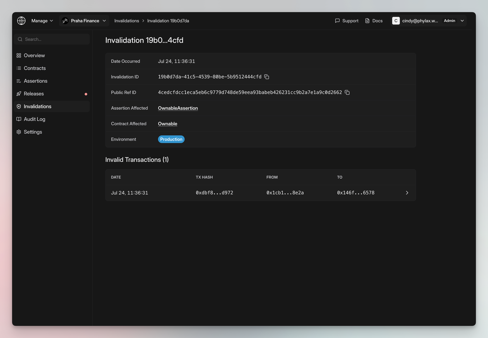

Use the [Phylax platform](https://ethereum.phylax.systems) to review circuit breakers and investigate rejected transactions. Your signers authorize policy changes.

## Review a Release

Open **Releases** and select the proposed change. Check the target contracts and environment, then review assertion additions, changes, and removals alongside the verification and backtesting results.

<Frame caption="Walk through a release's verification, source code, and backtesting results">
  <video controls playsInline preload="metadata" poster="/images/release-review-poster.png" aria-label="Circuit breaker release review walkthrough" style={{ width: "100%" }}>
    <source src="/images/release-review.mp4" type="video/mp4" />
  </video>
</Frame>

Investigate unexpected findings with your FDE before signing. [Release Review Checks](./release-review-checks) explains each check; [Backtesting Results](./backtesting) covers historical transaction findings.

## Authorize the Change

1. Confirm that the release contains the policies and contracts your team approved.
2. Connect the authorized policy-management wallet and select **Deploy to Alerting** or **Deploy to Production** for the release's environment.
3. Complete your signing process and wait for the configured activation delay.
4. Check the active rules and contract addresses. Your FDE verifies production protection with you.

Project access and deployment authority are separate. See [Managing Policy Deployments](./managing-policy-deployments) for permissions and [Deploy Assertions](./deploy-assertions-dapp#verify-ethereum-enforcement) for live enforcement checks.

## Investigate a Rejected Transaction

Open **Invalidations** and select the environment. Select an event to check its policy and contract. Open a transaction under **Invalid Transactions**.

<Tabs>
  <Tab title="Find the Transaction">
    <Frame caption="An invalidation event links the affected policy, contract, and transactions">
      
    </Frame>
  </Tab>
  <Tab title="Watch the Replay">
    <Frame caption="Follow a rejected ownership change through the replay, call details, and assertion trace">
      <video controls playsInline preload="metadata" poster="/images/invalidation-replay-poster.png" aria-label="Rejected transaction investigation walkthrough" style={{ width: "100%" }}>
        <source src="/images/invalidations.mp4" type="video/mp4" />
      </video>
    </Frame>
  </Tab>
</Tabs>

Compare the transaction execution result with the assertion result, rejection reason, and state changes. A protocol call can succeed in the replay while its assertion rejects the outcome.

In alerting mode, the violation is recorded without blocking the live transaction. In production, it reports a candidate excluded by a participating builder. An included transaction that reverts at an onchain guard is a separate event.

## Update or Remove a Circuit Breaker

Prepare a release with your FDE, developer, or an [AI coding agent](./agentic-pcl). Review its tests and diff before signing. Additions and removals take effect after the State Oracle delay.

For an emergency, follow your agreed [fallback and recovery procedure](./work-with-phylax#fallback-paths-and-recovery). To send violations to your team, follow [Setting Up Alerting](./setting-up-alerting).
