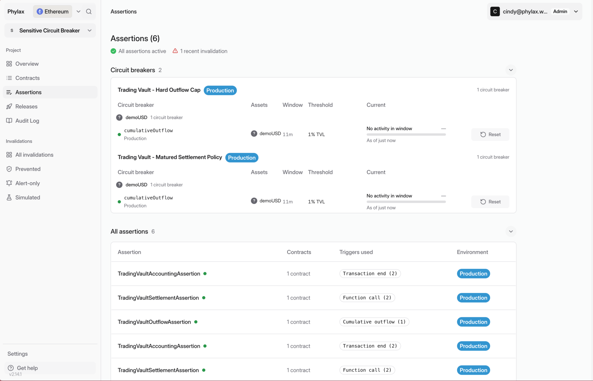
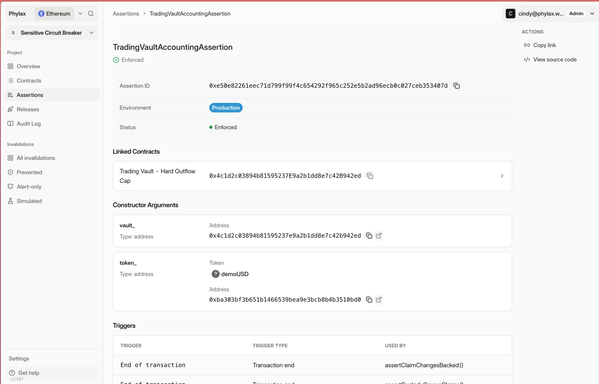
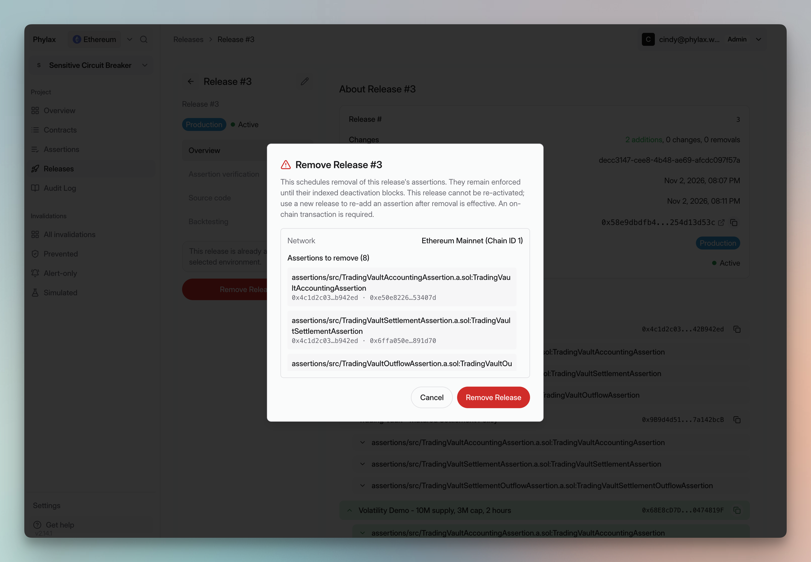

Use the [Phylax platform](https://ethereum.phylax.systems) to inspect active policies, replace their policy set, or remove a release. Your Protocol Manager signs deployments and removals. Assertions are managed as a complete release; you cannot remove them individually from an active release.

## Check Active Policies

Open **Assertions** to check assertion status and linked contracts. For cumulative-flow breakers, also review activity against the configured window and threshold. Other policies, such as an ownership check, do not necessarily have a rolling window.

<Tabs>
  <Tab title="Cumulative-Flow Breakers">
    <Frame caption="Review the pictured cumulative-flow breakers' environments, windows, thresholds, and activity">
      
    </Frame>
  </Tab>
  <Tab title="Assertion Details">
    <Frame caption="Inspect an assertion's configuration and use View source code to read its policy">
      
    </Frame>
  </Tab>
</Tabs>

## Deploy a replacement

Follow [Review and Deploy Policies](./deploy-assertions-dapp) for the canonical review, wallet authorization, activation, and live enforcement checks. Project access and [deployment authority](./managing-policy-deployments) are separate.

The screenshots on this page illustrate the documented workflow; their labels were not revalidated in an authenticated platform session during the November 17, 2026 documentation review.

## Replace or Remove a Release

To change or remove an individual assertion, prepare a **replacement release** with your FDE, developer, or [AI coding agent](./agentic-pcl). Include the complete set of policies you intend to keep. Review its diff and checks, then deploy it through the same signing process. Changes take effect after their configured delays.

To remove the entire release:

1. Open the active release and select **Remove Release**.
2. Check the network and the full **Assertions to remove** list.
3. Confirm **Remove Release** and authorize the onchain transaction with the Protocol Manager.
4. Wait for the indexed deactivation blocks and confirm that removal has taken effect.

<Frame caption="Remove Release schedules removal of all assertions in the release">
  
</Frame>

Production assertions remain enforced until their deactivation blocks; Alerting assertions continue observing until theirs. A removed release cannot be reactivated. To restore policies after removal takes effect, create and deploy a new release.

For an emergency, follow your agreed [fallback and recovery procedure](./work-with-phylax#fallback-paths-and-recovery).

For invalidation analysis, follow [Investigate a Rejected Transaction](./investigate-rejected-transaction).
