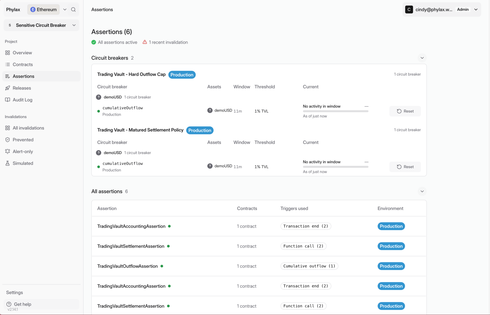
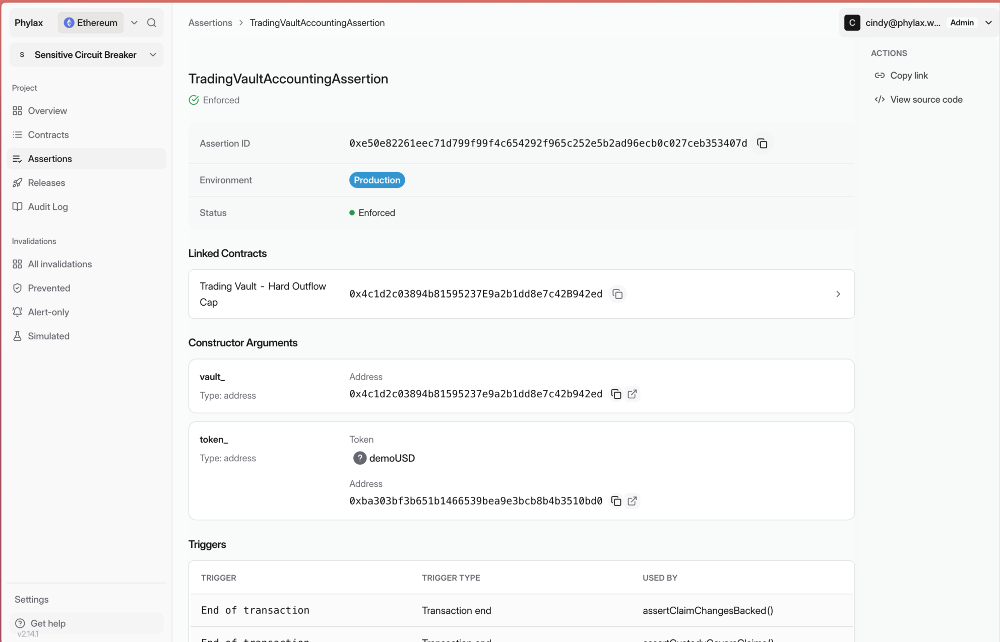
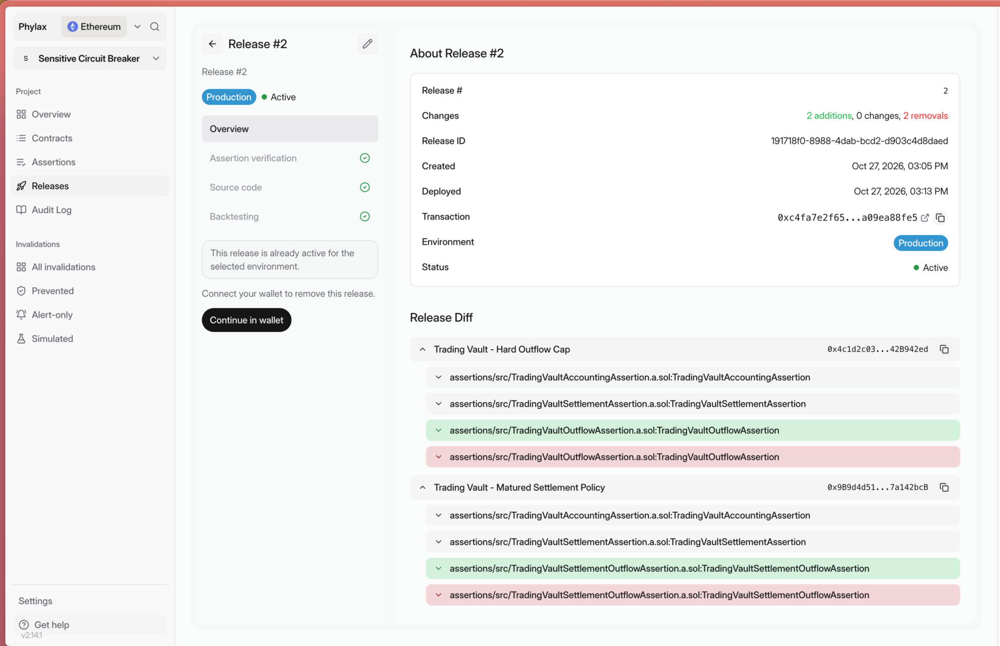
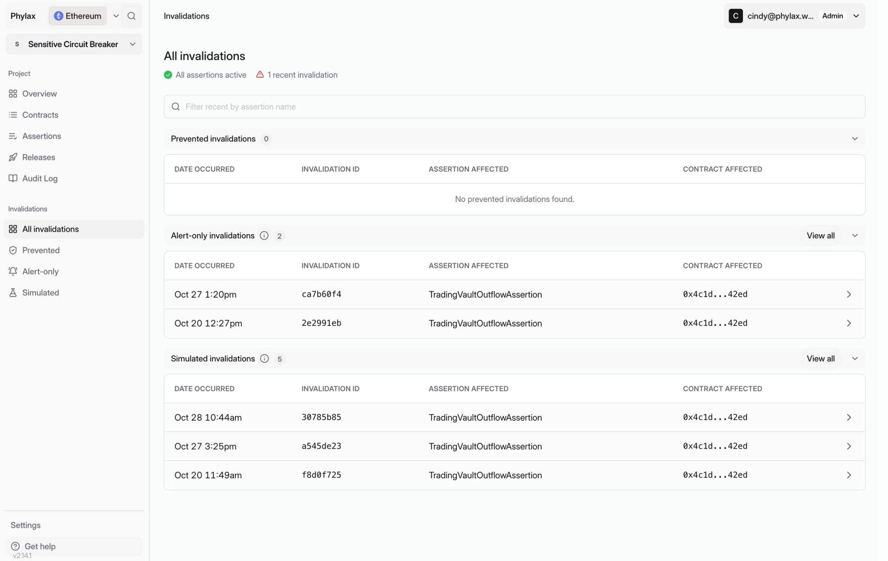
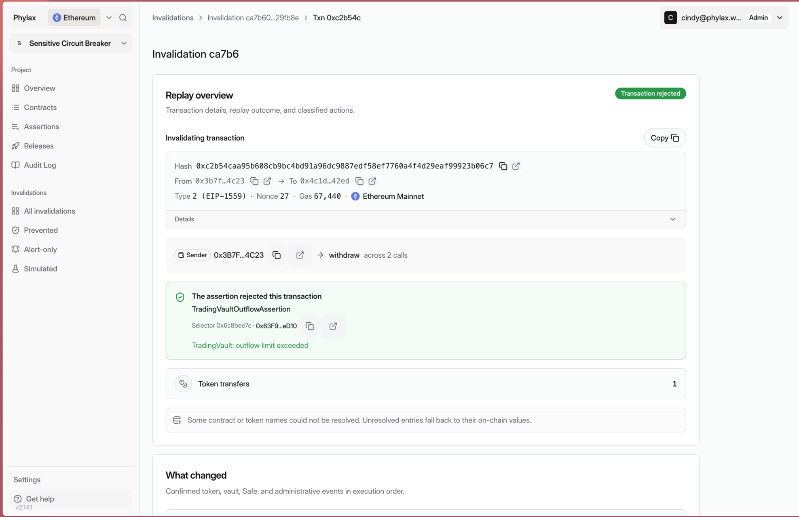
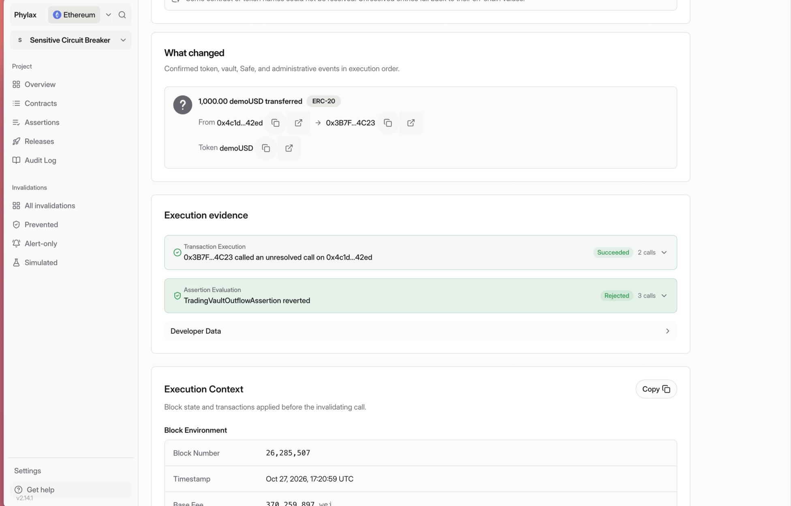

Use the [Phylax platform](https://ethereum.phylax.systems) to review circuit breakers and investigate rejected transactions. Your signers authorize policy changes.

## Check Active Policies

Open **Assertions** to review circuit-breaker activity against its window and threshold. Select an assertion to check its enforcement status and linked contracts.

<Tabs>
  <Tab title="Circuit Breakers">
    <Frame caption="Review each circuit breaker's environment, window, threshold, and current activity">
      
    </Frame>
  </Tab>
  <Tab title="Assertion Details">
    <Frame caption="Inspect an assertion's configuration and use View source code to read its policy">
      
    </Frame>
  </Tab>
</Tabs>

## Review a Release

Open **Releases** and select a release. Check its environment, target contracts, and **Release Diff**. Review **Assertion verification**, **Source code**, and **Backtesting** before authorizing deployment.

<Frame caption="An active production release showing its completed checks and policy additions and removals">
  
</Frame>

Investigate unexpected findings with your FDE before signing. [Review and Deploy Policies](./deploy-assertions-dapp#step-4-review-release-checks) explains each check; [Backtesting Results](./backtesting) covers historical transaction findings.

## Authorize the Change

1. Confirm that the release contains the policies and contracts your team approved.
2. Connect your authorized policy-management wallet to deploy the release to its selected environment.
3. Complete your signing process and wait for the configured activation delay.
4. Check the active rules and contract addresses. Your FDE verifies production protection with you.

Project access and deployment authority are separate. See [Managing Policy Deployments](./managing-policy-deployments) for permissions and [Review and Deploy Policies](./deploy-assertions-dapp#verify-ethereum-enforcement) for live enforcement checks.

## Investigate a Rejected Transaction

Open **All invalidations**. **Prevented** lists transactions blocked by enforcement; **Alert-only** lists violations observed without blocking live transactions; **Simulated** lists simulation results. Filter by assertion name and select an event.

<Frame caption="Invalidations are grouped by outcome; this example has alert-only and simulated events">
  
</Frame>

Open the transaction replay. Read the rejection reason in **Replay overview**, then compare **Transaction Execution** with **Assertion Evaluation** under **Execution evidence**.

<Tabs>
  <Tab title="Rejection Reason">
    <Frame caption="The replay identifies the assertion and its outflow-limit rejection reason">
      
    </Frame>
  </Tab>
  <Tab title="Execution Evidence">
    <Frame caption="The transaction succeeds in the replay, but the assertion rejects its outcome">
      
    </Frame>
  </Tab>
</Tabs>

This event is **Alert-only**. The **Transaction rejected** badge describes the replay result, not a live transaction being blocked. **What changed** shows the transfers and other events from that replay. An onchain guard revert is a separate event from an assertion rejection.

## Update or Remove a Circuit Breaker

Prepare a release with your FDE, developer, or an [AI coding agent](./agentic-pcl). Review its tests and diff before signing. Additions and removals take effect after the State Oracle delay.

For an emergency, follow your agreed [fallback and recovery procedure](./work-with-phylax#fallback-paths-and-recovery). To send violations to your team, follow [Setting Up Alerting](./setting-up-alerting).
