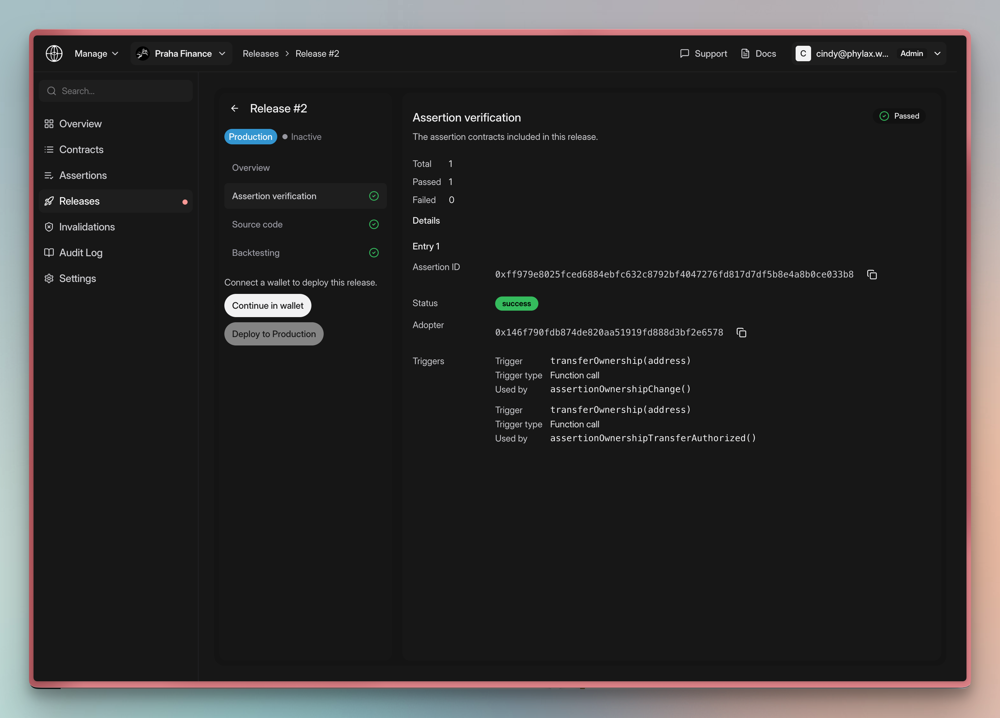

Release checks report assertion verification, source verification, and historical test results. Review all three with the release diff before deployment.

## Checks at a glance

| Check | What the platform reports | What you should confirm |
| --- | --- | --- |
| **Assertion verification** | Verification status, assertion ID, adopter, and registered triggers for each assertion contract | The release targets the intended contracts and every assertion uses the intended triggers |
| **Source code** | Source verification status for each submitted assertion ID | Every assertion in the release has a passing source result |
| **Backtesting** | Results from testing the release against transactions from the last 20,000 blocks | Any historical transaction that would have been invalidated is expected behavior rather than a false positive |

## Assertion verification

The check reports total, passed, and failed assertion counts, with these fields for each assertion:

| Field | Description |
| --- | --- |
| **Assertion ID** | Identifier for the assertion contract included in the release |
| **Status** | Verification result for that assertion |
| **Adopter** | Protected contract to which the assertion will be applied |
| **Trigger** | Registered function, selector, assertion trigger, or other trigger identifier |
| **Trigger type** | Trigger category, such as function call, transaction end, or cumulative outflow |
| **Used by** | Assertion function registered to the trigger, when applicable |

Compare the assertion IDs, adopters, and triggers with the approved policies. Verification checks the submitted configuration, not whether the policy protects the intended behavior.

<Frame caption="Assertion verification maps each assertion to its adopter and registered triggers">
  
</Frame>

## Source code

The check reports an **Assertion ID** and **Passed** value for each submitted assertion. Every ID in the release must have a passing entry.

Source verification does not audit the assertion or establish that its logic is correct.

## Backtesting

The **Backtesting** check tests every assertion in the release against transactions from the last 20,000 blocks. A passing result shows the tested block range, watched assertion IDs, number of transactions that exercised the assertions, and attempt history.

An **Issue found** result additionally identifies the matched transaction, assertion, block, and adopter. It also includes the incident payload, previous transactions, block environment, and replayed transaction data needed to investigate the finding.

See [How to Review Backtesting Results](./backtesting) for the complete investigation workflow in the platform.

## Interpreting the overall review

Resolve failed assertion or source checks before deployment. Investigate each backtesting finding and revise false positives.

Passing checks do not establish complete policy coverage. Continue with [local and integration tests](./testing-strategy) before production.

## Related documentation

<CardGroup cols={2}>
  <Card title="Apply Assertions" icon="code-branch" href="./apply-assertions">
    Create a release with `pcl apply`
  </Card>
  <Card title="Review Backtesting Results" icon="clock-rotate-left" href="./backtesting">
    Investigate historical transactions matched by a release
  </Card>
  <Card title="Deploy with the Platform" icon="rocket" href="./deploy-assertions-dapp">
    Authorize a reviewed release for alerting or production
  </Card>
  <Card title="Testing Assertions" icon="flask" href="./testing-assertions">
    Validate assertion behavior before deployment
  </Card>
</CardGroup>
