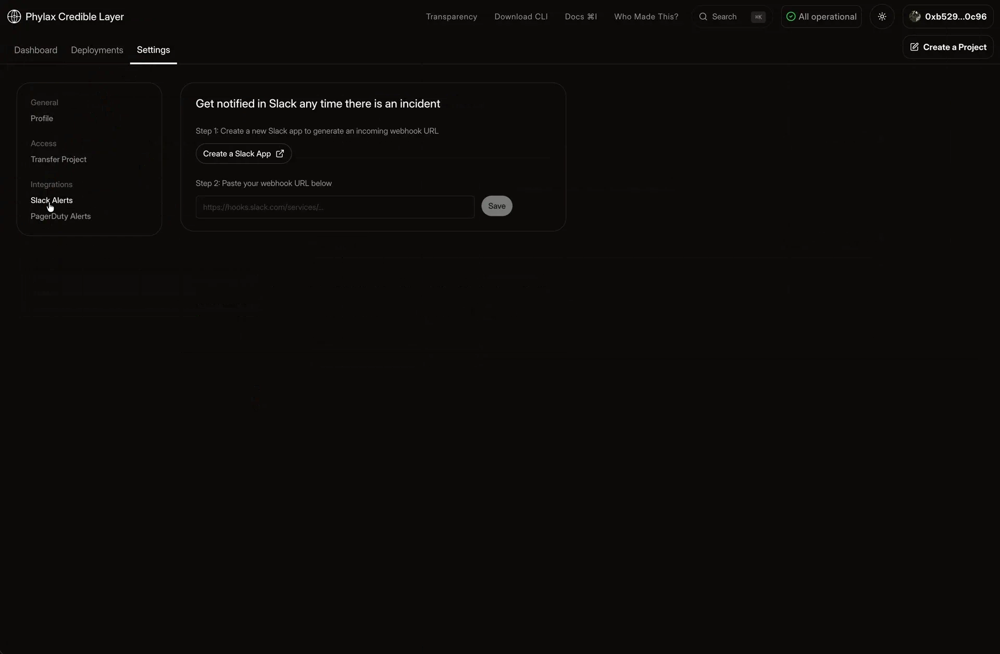

Send circuit-breaker notifications to Slack. You need project integration permissions and permission to create an app in your Slack workspace.

## 1. Open Slack Settings

Open your project in the [Phylax platform](https://ethereum.phylax.systems). Go to **Settings → Integrations → Slack**.

<Frame caption="Create a Slack app, then save its webhook URL in your project's Slack settings">
  
</Frame>

## 2. Connect a Slack Channel

1. Select **Create a Slack App**, choose your workspace, and create the app using the supplied configuration.
2. In Slack, open [**Incoming Webhooks**](https://docs.slack.dev/messaging/sending-messages-using-incoming-webhooks/) and enable it if needed.
3. Select **Add New Webhook to Workspace**, choose the channel that should receive alerts, and authorize the connection.
4. Copy the webhook URL, return to the project's Slack settings, paste it, and select **Save**.

## 3. Test the Connection

Select **Send Test Notification** and confirm that the message reaches your chosen Slack channel. If it does not, check the saved webhook and the app's access to that channel.

When a circuit-breaker alert arrives, follow its transaction link to [investigate the rejection](./managing-your-circuit-breakers#investigate-a-rejected-transaction). Agree with your FDE who responds and how to escalate an incident.
