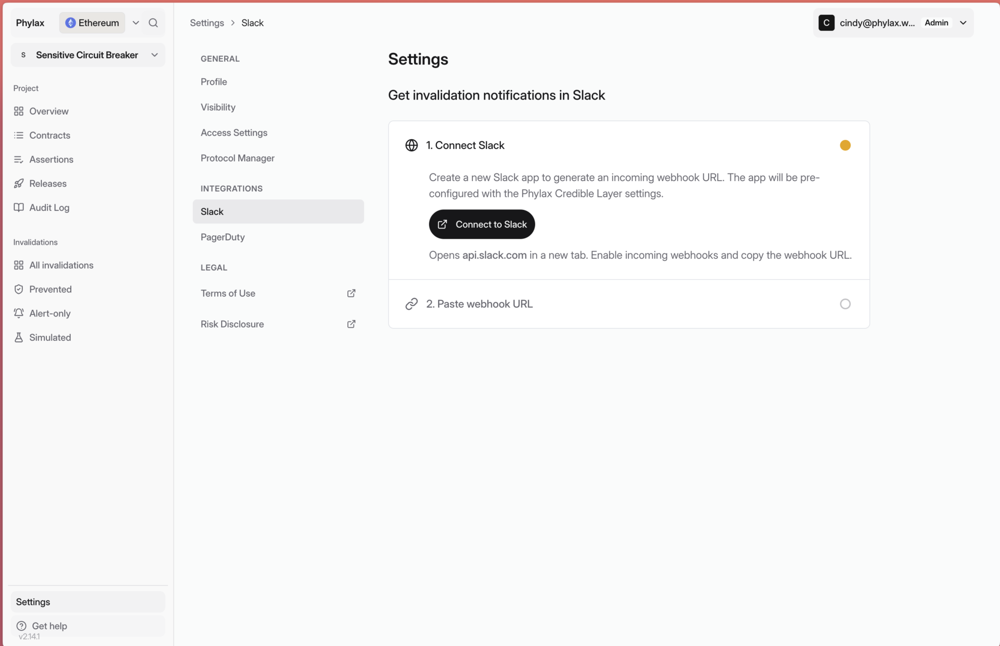
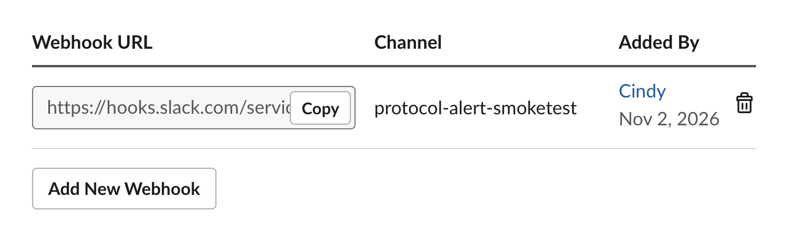
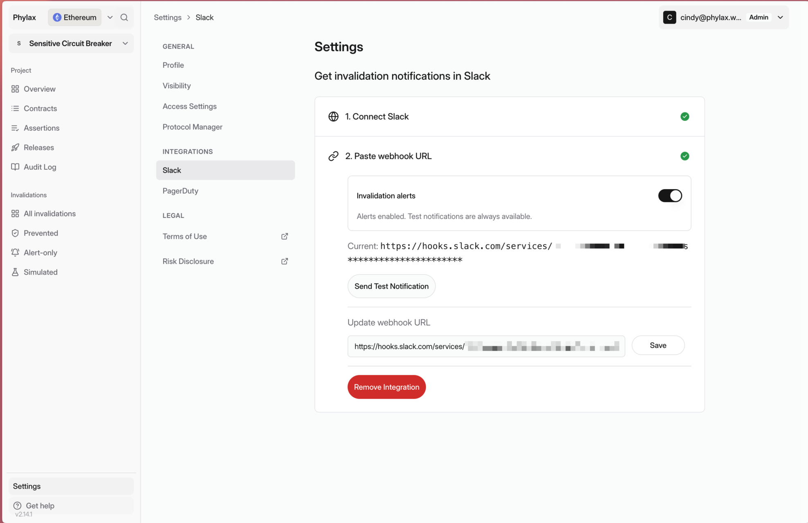
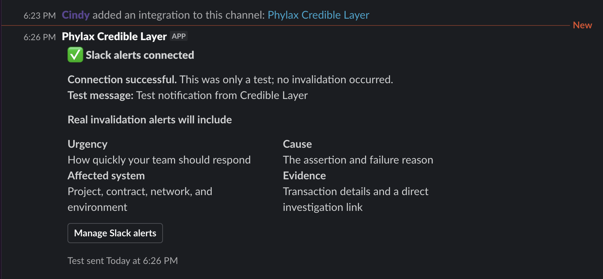

Send circuit-breaker notifications to Slack. You need project integration permissions and permission to create an app in your Slack workspace.

## 1. Connect Slack

Open your project in the [Phylax platform](https://ethereum.phylax.systems). Go to **Settings → Slack** under **Integrations**. Select **Connect to Slack** and create the preconfigured app in your Slack workspace.

<Frame caption="Connect to Slack from your project's integration settings">
  
</Frame>

## 2. Copy the Channel Webhook

In the Slack app settings, enable **Incoming Webhooks** and add a webhook for the channel that should receive alerts. Select **Copy** beside its URL.

<Frame caption="Copy the webhook for the channel that should receive alerts">
  
</Frame>

## 3. Save and Enable Alerts

Return to Phylax, paste the webhook URL, and select **Save**. Make sure **Invalidation alerts** is enabled.

<Frame caption="A saved webhook with invalidation alerts enabled">
  
</Frame>

## 4. Test the Connection

Select **Send Test Notification**. Confirm that **Slack alerts connected** appears in your chosen channel. If it does not, check the saved webhook and the app's access to that channel.

<Frame caption="The test message confirms the connection; no invalidation occurred">
  
</Frame>

When an alert arrives, follow its investigation link to [inspect the rejection](./managing-your-circuit-breakers#investigate-a-rejected-transaction).
